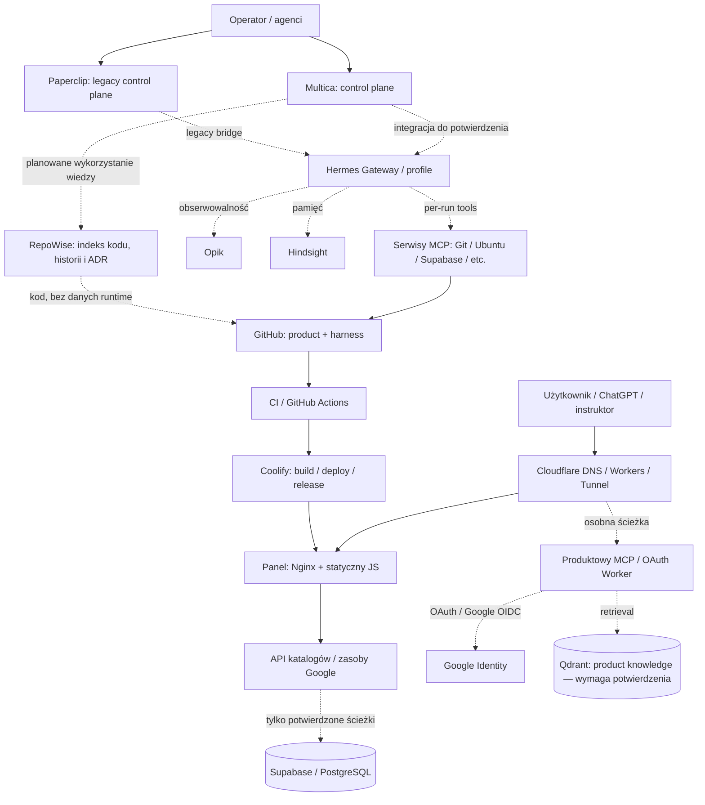

# Żar i Szlif — kompletna dokumentacja backendu i zaplecza technicznego

**Wersja dokumentu:** 1.0 — 2026-11-09 21:39 UTC / 22:39 Europe/Warsaw  
**Metoda:** odczyt kodu na VPS przez Ubuntu SSH; analiza RepoWise MCP; inspekcja Docker/Coolify runtime; bezpośrednie, tylko odczytowe próby HTTPS; odczyt metadanych PostgreSQL bez danych użytkowników.  
**Zakres:** backend produktu, API, MCP, baza danych, platforma agentów, bramki, pamięć, obserwowalność, CI/CD, infrastruktura i operacje.  
**Tryb:** dokumentacja bieżącego stanu (*as observed*). Nie jest automatycznym, stale aktualnym monitoringiem.  
**Poufność:** dokumentacja techniczna — nie publikować bez przeglądu informacji o topologii i konfiguracji. Nie zawiera wartości tokenów, haseł ani danych użytkowników.

> **Zasada interpretacji:** `kod istnieje` ≠ `został zbudowany` ≠ `jest wdrożony` ≠ `działa E2E`. Każda teza poniżej jest oznaczona w tekście jako **[LIVE]** (bezpośrednia obserwacja), **[SOURCE]** (potwierdzony kod), **[DOC]** (deklaracja z dokumentacji), **[PARTIAL]** (niepełne dowody), albo **[OPEN]** (brak weryfikacji). „Healthy” oznacza status healthchecku, a nie udany przebieg biznesowy.

## Spis treści

1. Zakres, źródła prawdy i wersjonowanie  
2. Architektura logiczna i granice odpowiedzialności  
3. Backend produktu i model danych  
4. Interfejsy HTTP, OAuth i narzędzia MCP produktu  
5. Baza wiedzy/RAG i system pamięci  
6. Platforma agentowa: Multica, Hermes, Paperclip, OpenCode  
7. MCP i usługi infrastrukturalne  
8. Bazy, stan i przechowywanie  
9. Infrastruktura Docker/Coolify/Cloudflare i sieć  
10. CI/CD, promocja, rollback i provenance  
11. Obserwowalność, logi, monitoring i bezpieczeństwo  
12. Operacje, runbooki i procedury diagnozy  
13. Macierz weryfikacji E2E  
14. Luki, ryzyka i zalecana kolejność domknięcia  
15. Indeks źródeł kodu i ścieżek  
16. Granice tego audytu

---

## 1. Źródła prawdy i identyfikatory wersji

### 1.1 Repozytoria

| Repozytorium | Właściciel | Adres | Odczytany checkout na VPS | RepoWise MCP |
|---|---|---|---|---|
| `product` — `zar-i-szlif` | Kod aplikacji, UI, logika domenowa, własne Workers/MCP | `https://github.com/miloszspyrka-code/zar-i-szlif` | `81c4b068b89f4c035098c6c9107f755f56919a87` | indeks dla `product` na tym samym SHA |
| `harness` — `harness-zar-i-szlif` | Infrastruktura, ogólne MCP, integracje, release, agent runtime | `https://github.com/miloszspyrka-code/harness-zar-i-szlif` | `0d19ac3221a05a16e9f7b8a4a4fb57c3911da8a4` | indeks `531335f209172e3ba096f7ef7ba50e08c81a6e67` |

**[LIVE]** Przeczytane katalogi źródłowe: `/opt/repowise-knowledge/fresh-main/product` i `/opt/repowise-knowledge/fresh-main/harness`. RepoWise ma workspace z aliasami `product` i `harness` i zgłasza 669 plików kodu / 5925 symboli w indeksie. Wersje checkoutów, indeksów i działających artefaktów **nie są tożsame**. Przy aktualizacji dokumentu odczytać wszystkie trzy, zamiast wybierać arbitralnie jeden SHA.

**[PARTIAL]** `get_overview(repo="product")` w tej sesji zwrócił tytuł i opis `Repository Overview: harness` oraz moduły Paperclip, mimo wskazania repo `product`. Nie należy korzystać z tego wyniku jako dokumentacji aplikacji. Fakty o produkcie w niniejszym dokumencie pochodzą z bezpośrednio czytanych plików `product`.

**[PARTIAL]** RepoWise `get_answer` zgłosił `no-llm-provider`, `confidence=low`, `retrieval_quality=weak`; automatyczna synteza nie jest dostępna. Wspiera wyszukiwanie i analizę statyczną, ale nie zastępuje odczytu źródeł. Raport architektury `9,9/10` opiera się na częściowym grafie i nie jest wynikiem testu produkcyjnego. `get_conformance`: **0 zadeklarowanych reguł**, zatem „0 violations” nie oznacza zgodności z przyjętą architekturą.

### 1.2 Faktyczna wersja panelu i kontener

**[LIVE]** `https://panel.zariszlif.pl/healthz` → HTTP 200, body `ok`; `https://panel.zariszlif.pl/__release.json` → HTTP 200:

```json
{"commit":"98cd058155dbf4c268777246fc510324f98f7dc5","source":"zar-i-szlif/main"}
```

Podczas inspekcji kontener `cs847jiwtuq5rlm8ntjeohgf-20261109T212537`, obraz z wewnętrznego registry oznaczony powyższym SHA, status `healthy`; lokalny Docker image ID `sha256:478ab8d0fd10fbbb4f6162e05f41ae4d82f3e75745be10cacf48d6833847fdfe`. **Nie** jest to dowód kompletnego backendu aplikacji; jest to dowód działającego wydania statycznego frontendowego serwowanego przez Nginx.

**Uwaga o źródle:** checkout produktu ma SHA `81c4b...`, a live release `98cd058...` — dokumenty w checkoutcie mogą opisywać inną rewizję niż uruchomiony frontend. Raporty z repo nie mogą udawać dokładnych źródeł dla obrazu uruchomionego pod innym SHA.

## 2. Architektura logiczna i odpowiedzialność



Strzałki **ciągłe** oznaczają funkcję potwierdzoną kodem lub statusem uruchomienia; **przerywane** oznaczają zależność zadeklarowaną, projektowaną albo niezweryfikowaną E2E. Diagram logiczny nie jest skanem pakietów ani kompletnym grafem połączeń.

### 2.1 Granice

- **Produkt**: `app/web` (przeglądarka), `app/plugin` (lokalny serwer MCP/SDK), `app/cloudflare-worker` (starszy Worker panelu/OAuth), `app/mcp-worker` (wydzielony produktowy Worker wiedzy), `ops/coolify` (statyczny serwer Nginx), domena produktu, schematy i treści.
- **Harness**: `paperclip-mcp`, `integrations/hermes-paperclip`, `multica-mcp`, `supabase-mcp`, `qdrant-mcp`, `mantic-mcp`, `emailens-mcp`, `ubuntu-mcp`, `plasmic-mcp`, `comfyui-mcp`, `opik-*`, integracje i runbooki infrastruktury.
- **Kod a runtime**: część źródeł produktu korzysta ze starych identyfikatorów `Kompas Zbiórek`, `kompas-zbiorek`, `kompas-knowledge-v1`. Nie oznacza to automatycznie migracji schematu, danych ani hostname'ów na nową markę.
- **Trwałość**: żaden agent nie powinien traktować lokalnego frontendu, Qdrant, Hindsight, RepoWise i PostgreSQL jako jednej wspólnej bazy danych. Każdy ma inną odpowiedzialność, wersję źródła i politykę retencji.
- **Historia**: archiwum 108 stron Paperclip Wiki jest źródłem historycznym, nie aktywną polityką Multica/Hermes.

### 2.2 Brak założonej „jednej wersji platformy”

Aplikacje Coolify, usługi Docker, Workers Cloudflare i indeks RepoWise są wydawane oddzielnie. Numer SHA panelu nie identyfikuje Hermes, Multica, Opik ani wersji schematu SQL. Dla każdego przepływu należy zapisywać `repo/ref/SHA → CI → image digest → deployment UUID → readback`.

## 3. Backend produktu i dane

### 3.1 Rzeczywista rola web runtime

**[SOURCE]** `product/ops/coolify/Dockerfile` ma build stage na `node:24-bookworm-slim`, uruchamia lint/typecheck/test, buduje statyczne `app/web/dist`, a następnie serwuje artefakt przez `nginx:alpine`. `ops/coolify/nginx.conf` wystawia `/healthz`, przekierowuje `/panel` i `/panel/*` na starszą domenę `panel.kompaszbiorek.pl`, a pozostałe ścieżki obsługuje jako SPA fallback do `index.html`. Skrypt `40-release-provenance.sh` tworzy artefakt release readback z `SOURCE_COMMIT`.

**Wniosek:** produkcyjny kontener WWW jest **statycznym serwerem frontendowym**, nie monolitycznym Node API i nie serwerem MCP. Port kontenera: `80/tcp`; HTTPS kończy się wcześniej na edge/proxy. Należy oddzielnie sprawdzić live Worker OAuth i wszystkie API wywoływane przez browser.

### 3.2 Główne funkcjonalności produktu

Repo i historia opisują: Zbiórka/Camp, Karta Zbiórki, Patrol/Namiot, Sprawności i Stopnie, Dziennik aktywności, Plan roczny, onboarding i zaproszenia. Obecność funkcji w dokumentacji lub w stanie frontendu **nie potwierdza** wdrożonego backendu tych modułów. W aktualnym audycie nie znaleziono pełnego modelu relacyjnego obsługującego te wszystkie domeny.

**[SOURCE]** `app/web/src/static-app-v2.js` korzysta m.in. z:

- `localStorage["kompas-zbiorek-draft-v1"]` dla szkicu stanu aplikacji, zadań, aktywności, planu i wybranych danych drużyny; jest to zapis **w obrębie przeglądarki**, a nie potwierdzona synchronizacja serwerowa.
- `localStorage["kompas-picked-doc"]` dla wyboru dokumentu Google; część operacji próbuje również użyć `/panel/context` po uwierzytelnieniu.
- `indexedDB` dla cache katalogów; nie zakładać, że cache jest systemem prawdy ani kopią zapasową.
- `GET /api/activities` i `GET /api/skills` na zdefiniowanych w JS hostach API, a także Google Picker/Sheets z uwierzytelnionego kontekstu. Hosty, uprawnienia i wersje endpointów wymagają bieżącego odczytu konfiguracji przed zapisaniem jako produkcyjne API.

**[OPEN]** Nie ma potwierdzonego relacyjnego systemu CRUD dla całych drużyn, zaproszeń, obozów i planu rocznego; nie wolno dokumentować ich jako produkcyjnych endpointów wyłącznie na podstawie koncepcji lub UI.

### 3.3 Wykryty PostgreSQL/Supabase

**[LIVE]** Kontener `db-r2gnunvpkqwmuew1tupbf7lx` (`supabase/postgres:17.6.1.136`) odpowiada na read-only `psql`. W `public` istnieje **jedna wykryta tabela domenowa**:

| Tabela | Kolumna | Typ SQL | Nullable |
|---|---|---|---|
| `public.sprawnosci` | `id` | `text` | nie |
| | `poziom` | `text` | nie |
| | `aspekt` | `text` | nie |
| | `grupa` | `text` | nie |
| | `grupa_label` | `text` | nie |
| | `tytul` | `text` | nie |
| | `wymagania` | `ARRAY` | nie |

**[LIVE]** RLS (`rowsecurity=true`) włączony. Wykryta polityka `sprawnosci_select_public`, `SELECT`, rola `public`, predykat `true` (odczyt jawny dla podmiotów uprawnionych do SELECT). Indeksy: `sprawnosci_pkey`, `sprawnosci_grupa_idx`, `sprawnosci_poziom_aspekt_idx`, `sprawnosci_poziom_grupa_tytul_key`. Szacunkowo `reltuples≈300` (to estymata katalogowa, **nie dokładny COUNT**). Nie odczytywano rekordów użytkowników ani wartości tabeli.

**[PARTIAL]** W bazie istnieją także schematy systemowe Supabase (`auth`, `storage`, `realtime`, `vault`, itd.), lecz ich obecność nie dowodzi istnienia kont/sesji użytkowników aplikacji. Stwierdzenie w kodzie `app/mcp-worker` „Supabase remains SSOT” jest deklaracją architektoniczną, którą trzeba skonfrontować z rzeczywistym mapowaniem encji i danymi produkcyjnymi.

### 3.4 Macierz źródeł prawdy

| Rodzaj danych | Obecny mechanizm / kod | Co jest potwierdzone | Czego nie wolno założyć |
|---|---|---|---|
| Katalog sprawności | Supabase `public.sprawnosci`; kod JS `/api/skills` | tabela, RLS i schemat; frontend ma klienta API | że cały katalog live pochodzi z tej konkretnej bazy bez weryfikacji hosta |
| Szkic użytkownika | `localStorage` | kod zapisujący lokalnie | serwerowa synchronizacja, multi-device, recovery |
| Cache katalogów | `indexedDB` | kod cache | trwała baza domenowa |
| Autoryzacja Google/MCP | Workers/OAuthProvider/OIDC | kod | publiczny produkcyjny login i działające granty |
| Dokumenty wiedzy | Qdrant / Workers AI | kod filtrów i narzędzi | gotowa kolekcja i poprawne połączenie live |
| Wiedza o repo | RepoWise | działający indeks dwóch repo | semantyczna prawda runtime i pełna aktualność |
| Agent memory | Hindsight | zdrowe kontenery | automatyczny, kompletny zapis każdej sesji |

## 4. API, protokoły i kontrakty

### 4.1 Produktowy lokalny MCP (Node/Express)

**[SOURCE]** `app/plugin/index.ts`:

| Metoda | Ścieżka | Zachowanie z kodu |
|---|---|---|
| `POST` | `/mcp` | MCP Streamable HTTP, transport bezstanowy; nowy serwer na żądanie |
| `GET` | `/mcp` | HTTP 405, brak SSE w tej implementacji |
| `DELETE` | `/mcp` | HTTP 405 |
| `GET` | `/health` | obiekt `ok` i nazwa serwera |
| `GET` | `/.well-known/oauth-protected-resource` | RFC 9728, zależne od poprawnego `PLUGIN_PUBLIC_ORIGIN` |

Lokalny proces: `npm --prefix app run build`, `npm --prefix app run start`, host `127.0.0.1:8787`. **To nie jest wykaz endpointów wystawionych przez produkcyjne Nginx**.

**Narzędzia lokalnego `app/plugin/server.ts`:** `pokaz_kompas_zbiorek` (publiczne demo UI), `search_knowledge`, `get_knowledge_source`, `search`, `fetch` (wiedza i Company Knowledge). Narzędzia wiedzy wymagają backendu retrieval. Lokalny `auth.ts` sprawdza obecność Bearer, ale **sam nie weryfikuje JWT**; polega na zewnętrznym adapterze tożsamości. Nie wystawiać surowego lokalnego serwera jako zaufanego publicznego endpointu dla danych prywatnych bez egzekwowania weryfikacji tokenu na brzegu.

### 4.2 Wydzielony Worker produktowego MCP

**[SOURCE]** `app/mcp-worker/src/index.ts` (nazwa `zar-i-szlif-mcp`, konfiguracja `app/mcp-worker/wrangler.jsonc`, docelowy origin `https://mcp.zariszlif.pl`):

| Metoda / endpoint | Cel | Autoryzacja |
|---|---|---|
| `GET /health` | readiness logiczny handlera | publiczny handler |
| `GET /` | informacja „connect at /mcp” | publiczny handler |
| `GET/POST /authorize` | rozpoczęcie login/consent | OAuth / Google OIDC |
| `GET /callback` | callback Google | OAuth/CSRF |
| `/token` | token OAuth | biblioteka OAuthProvider |
| `/register` | dynamic client registration | allowlista redirect URI |
| `POST /mcp` | wywołania JSON-RPC MCP | bearer/grant + `knowledge.read` |
| `/.well-known/*` | metadane OAuth/Protected Resource | OAuthProvider |

**Dokładnie cztery narzędzia tego wydzielonego Workera:** `search_knowledge`, `get_knowledge_source`, `search`, `fetch`. Nie wystawia starszego narzędzia UI. Scopes: `knowledge.read` oraz `offline_access`. Odpowiedzi mają `structuredContent` i JSON w `content`; retrieval ma server-derived scope użytkownika i read-only annotations. Wymaga `QDRANT_URL` **oraz** bindingu Workers AI dla faktycznych zapytań. Przy braku wymaganego backendu wiedzy narzędzia odmawiają działania.

**[SOURCE / RYZYKO]** Kod żąda `env.OAUTH_KV`, `GOOGLE_CLIENT_ID`, `GOOGLE_CLIENT_SECRET`, `COOKIE_ENCRYPTION_KEY`. Odczytana konfiguracja `app/mcp-worker/wrangler.jsonc` deklaruje `AI`, `MCP_PUBLIC_ORIGIN`, allowlistę redirect URI, **ale nie zawiera deklaracji `OAUTH_KV`**. Nie znaczy to, że Worker nie może mieć osobno ustawionego bindingu, ale przy wdrożeniu wyłącznie na podstawie tej konfiguracji guard zwróci 503. Nie należy uzupełniać doraźnie bez kontroli istniejącej produkcji Cloudflare.

**[LIVE/PARTIAL]** Próba `https://mcp.zariszlif.pl/health` z VPS nie nawiązała skutecznego połączenia (`curl http_code=000`). To **nie jest** dowód błędu aplikacji po stronie Workera; możliwe problemy DNS/host/routing lub brak wdrożenia. Nie oznaczać endpointu jako sprawnego ani jako jednoznacznie nieczynnego bez dalszej diagnozy DNS, TLS i Cloudflare.

### 4.3 Starszy Worker panelu / OAuth

**[SOURCE]** `app/cloudflare-worker/src/oauth.ts`, `mcp.ts`, `google-handler.ts`, `identity.ts`, `dcr.ts`, `panel-handler.ts`, `sender.ts`. Przewidziane: OAuth 2.1 z PKCE S256, Google jako upstream OIDC, dynamic client registration z kontrolą redirect URI, `/mcp`, UI/panel, pośrednictwo w wybranych API i opcjonalna synchronizacja kontaktu. Worker jest OAuth AS wobec ChatGPT i OAuth client wobec Google; token Google **nie jest** tokenem MCP. `panel-handler.ts::resolvePanelSession` w odczytanym kodzie zwraca `null` (miejsce adapterowe); nie traktować tego kodu jako dowodu trwałych sesji panelu.

**Historyczne ścieżki:** w `wrangler.jsonc` występują domeny `kompaszbiorek.pl` oraz binding `OAUTH_KV`. Zgodnie z dokumentacją repo istnieją trzy zachowane Workers (`stronaglowna`, `zariszlif-prawne`, `paperclip-mcp`), które mają osobne linie wydań. Sama konfiguracja historycznej ścieżki nie dowodzi, że dany Worker jest aktywny na nowej domenie produktu.

### 4.4 Interfejsy backendowe platformy (przegląd)

| Usługa | Interfejs / charakter | Potwierdzenie | Uwaga |
|---|---|---|---|
| Supabase MCP | `GET /health`, `POST /mcp`; GET/DELETE `/mcp` mają odmowę w stateless | `harness/supabase-mcp/src/server/http-server.ts` | middleware JWT na `/mcp` |
| Qdrant MCP | HTTP Streamable MCP `/mcp` i/lub transport zależny od launch | `harness/qdrant-mcp/server/server.py` | opcjonalny guard Bearer, nie zakładać anonimowości |
| Paperclip MCP | MCP narzędzi kontrolnych przez SDK i gateway | `harness/paperclip-mcp/src/index.ts`, `execution-broker.ts` | prawo do wykonania zależy od roli, run i route; nie tylko nazwy narzędzia |
| Hermes Gateway | profile, run-scoped narzędzia, walidacja grant envelope | `harness/integrations/hermes-paperclip/gateway/run_mcp.py` | fail-closed; token run nie powinien być logowany/persistowany |
| Multica MCP | wrapper na przypiętą wersję CLI, HTTP/stdio | `harness/multica-mcp/server.mjs` | oddzielne od `multica-backend:v0.8.1` |
| RepoWise MCP | private Streamable HTTP pod `http://repowise-mcp:7338/mcp` | połączenia MCP i auth testowane w dawnym readbacku oraz zapytania tej sesji | auth 401 dla złego tokenu, brak pełnego LLM provider |
| Opik MCP | broker do Opik, guarded ingress | kontenery `opik-mcp`, `access-guard` | zdrowy kontener ≠ pełne trace E2E |
| Mautic/Mantic MCP | operacje kampanii, kontaktów, maili, segmentów | `harness/mantic-mcp/src/` | nie mylić z backendem aplikacji RR |

Dokumentacja nie rości sobie prawa do kompletnego OpenAPI serwisów zewnętrznych; nie wszystkie posiadają udostępnioną specyfikację, a część jest prywatna i wersjonowana niezależnie. Powyższe endpointy są cytowalne do lokalnych ścieżek i testowane tylko w wymienionym zakresie.

## 5. Wiedza, pamięć i retrieval

### 5.1 Dlaczego są trzy osobne systemy

| System | Co przechowuje / indeksuje | Powinien być źródłem prawdy dla | Czego nie powinien dublować |
|---|---|---|---|
| **RepoWise** v0.60.1 | kod, graf zależności, symbole, pliki, historia Git, decyzje ADR, dokumentacja repo | „co jest w kodzie / jak się zmieniało / co zależy od czego” | pełne rozmowy, osobistą pamięć agentów, aktualny stan runtime bez readbacku |
| **Hindsight** | trwałe, odwoływalne doświadczenia i kontekst agentów, banki pamięci | „co agent odkrył, wykonał, jakie reguły robocze obowiązują” z datą i pochodzeniem | kopii modułów kodu, zrzutów całych PR, technicznych symboli już dostępnych w RepoWise |
| **Qdrant** | wektory/chunki i wyszukiwanie semantyczne | produktowy RAG, kolekcje dokumentów albo pamięć wektorową według własności | logów wdrożeń, relacyjnego stanu uprawnień, surowych sekretów |
| **Opik** | eksperymenty, ślady wykonania modeli/narzędzi, metryki | diagnostyka realnego przebiegu agent/run | autorytatywnych decyzji review i wydania, nieograniczonego magazynu rozmów |

**Proponowany kontrakt minimalnej kanibalizacji pamięci** (wymaga wdrożenia w konfiguracji polityk agentów; nie stwierdzono produkcyjnego E2E):

1. Kod, API, zależność, zmiana pliku, historia PR → **RepoWise / GitHub**. Do Hindsight tylko krótka referencja: `repo`, `SHA`, `ścieżka`, `decision_id` lub `issue_id` oraz powód istotny dla działania, bez kopiowania treści.
2. Stan wykonania, wynik testu, błąd runtime, decyzja o naprawie, wiedza o środowisku → **Hindsight**, ale z `observed_at`, `environment`, `source_sha`, linkiem do Opik/Coolify i TTL/retencją.
3. Pełen trace i metryki kosztu/latency → **Opik**; do Hindsight krótka wyselekcjonowana lekcja z trace ID, a nie każdy event.
4. Treść dokumentów dostępnych instruktorom → osobna, uprawniona kolekcja produktowego RAG; **nie** indeksować tam infrastruktury, sekretów lub wiedzy prywatnych agentów.
5. RepoWise z zaindeksowanym SHA nie jest samoistnym potwierdzeniem aktywnej wersji; agent przed zmianą runtime porównuje je z GitHub i digestem Coolify.

### 5.2 Produktowy pipeline wiedzy

**[SOURCE]** `app/plugin/knowledge/` ma następujące główne pliki:

- `schema.ts` — definicje kolekcji, tenant, payload, filtrowanie po widoczności, walidacja pól, indeksy.
- `sources.ts` — pobieranie/normalizacja źródeł dopuszczonych do indeksowania.
- `denylist.ts` — blokowanie wyłączonych źródeł/treści przed indeksem i retrieval.
- `pipeline.ts` — `source → normalize → chunk → embed → upsert`; stable ID i hash, usuwanie osieroconych chunków; allowlista źródeł z obiektem bez prototypu.
- `embeddings.ts` — integracja Workers AI `@cf/baai/bge-m3`.
- `qdrant.ts` — klient kolekcji, upsert/search/delete i auth-filter.
- `retrieval.ts` — prefilter silnika i obronny postfilter wyników.
- `mcp-tools.ts` — kontrakty `search_knowledge`, `get_knowledge_source`, `search`, `fetch`.
- `memory.ts`, `smoke.ts` — lokalne/smoke implementacje pomocnicze.

Zdefiniowane wartości: `COLLECTION_NAME=kompas-knowledge-v1`, `TENANT=kompas-zbiorek`, `EMBEDDING_MODEL=@cf/baai/bge-m3`, `VECTOR_SIZE=1024`, dystans `Cosine`. Chunking 1200 znaków z overlap 150; retrieval domyślnie `topK=8`, limit `20`, `minScore=0.35` (próg konfigurowalny). Indeksowanie dopuszcza między innymi `skills-catalog`, `marketing`, `onboarding-emails`, `help-page`, `legal`, `runtime-doc`; źródła prywatne podlegają filtrowi user/workspace i denyliście.

**Autoryzacja retrievalu:** tenant musi się zgadzać, a wynik musi być `global` albo dotyczyć tożsamości użytkownika/jej workspace. `sourceIds` ogranicza wyszukiwanie do kodowej allowlisty; błędna wartość powinna fail-closed. Weryfikować zarówno prefilter Qdrant, jak i filtr obronny w kodzie. Nie uznawać samego promptu za zabezpieczenie izolacji danych.

### 5.3 Krytyczna rozbieżność Qdrant

**[LIVE]** `GET http://127.0.0.1:6333/collections` na hostowym Qdrant `qdrant/qdrant:1.20.0` zwrócił **wyłącznie** kolekcję `long_term_memory`. **Nie wykryto** tam `kompas-knowledge-v1` zadeklarowanej w kodzie produktu. To jest obserwacja konkretnej instancji pod hostowym portem 6333, nie dowód, że nie istnieje inna kolekcja w innym klastrze Qdrant. W razie podpięcia tego hostowego Qdrant do produktowego MCP wiedza produktowa nie będzie kompletna bez utworzenia, wypełnienia i smoke tej kolekcji. Nie wykonywano mutacji kolekcji.

**[LIVE]** Qdrant hostowy słucha na `0.0.0.0:6333`; rzeczywistą dostępność z Internetu i kontrolę ACL/firewall należy niezależnie przetestować. Fakt nasłuchu nie dowodzi publicznej ekspozycji spoza sieci. Nie udostępniać bez potrzeby portów magazynu pamięci publicznie.

### 5.4 RepoWise — aktualność i wiarygodność

**[LIVE]** `list_repos`: dwa repozytoria; `get_architecture`: 14 węzłów usług, 4 runtime edges, 9 wykrytych izolowanych usług, brak udowodnionego pełnego grafu; wynik 9,9/10 opisuje wyłącznie **strukturę wykrytą częściowo**. `get_conformance` nie miał zadeklarowanych reguł do ewaluacji. RepoWise `get_health(repo="harness",scope="production")` wyliczył ważoną ocenę ~5,1/10 dla analizowanych plików produkcyjnych, a najcięższe problemy lokalizuje w `paperclip-mcp/src/control-plane.ts`, `workspace-native.ts`, `tools.ts`. Te metryki nie są prawdopodobieństwem awarii.

**[DOC]** RepoWise API i wewnętrzny MCP potwierdzono wcześniej w `/harness/docs/knowledge/REPOWISE-E2E-STATUS.md` (`initialize`, `tools/list`, `list_repos`, `get_architecture` oraz negatywne 401). RepoWise `get_answer` bez dostawcy LLM działa tylko w trybie retrieval. Brak potwierdzenia automatycznej synchronizacji prywatnych repo po każdym push, pełnej poprawności grafu, ani uruchomienia z konkretnej sesji Multica/Hermes.

## 6. Platforma agentowa

### 6.1 Multica

**[LIVE]** Kontenery w projekcie `6ihjnudsifbcvklz5hqxdldc`: `ghcr.io/multica-ai/multica-backend:v0.8.1` (`backend-*`, healthy), `ghcr.io/multica-ai/multica-web:v0.8.1` (`frontend-*`, healthy), PostgreSQL/pgvector 17 (`postgres-*`, healthy) oraz Mailpit (`mailpit-*`, healthy). `https://multica.zariszlif.pl/` odpowiada HTTP 200 HTML.

**Nie wynika z tego:** zarejestrowany daemon profilu, prawidłowe role, migracja 14 agentów, zapis i odzysk zadania, połączenie GitHub App, Hermes, Hindsight/Opik i automatyczny release. W tym audycie nie wykonywano prawdziwego zadania i nie zmieniano konfiguracji Multica.

**[SOURCE: RepoWise]** `harness/multica-mcp/server.mjs` jest osobnym serwerem adapterowym, z wrapperem przypiętego CLI, walidacją flag i redakcją wartości wyglądających jak sekret. Nie utożsamiać istnienia pliku lub jego testów z aktywnym narzędziem w każdym agencie. Plik należał do innej rewizji harness niż lokalnie odczytany starszy checkout.

### 6.2 Hermes Gateway

**[SOURCE]** `harness/integrations/hermes-paperclip/gateway/Dockerfile` opiera obraz na `nousresearch/hermes-agent:v0.22.5`, dokłada walidator run-scoped MCP i kompiluje go przy budowie. `run_mcp.py` realizuje fail-closed kontrolę envelope: sprawdza `version`, `company_id`, `agent_id`, `issue_id`, `run_id`, `profile`, ograniczenia URL i format tokenu; narzędzia są pożyczane na zakres jednego run i mają być następnie wycofane. Bearer ma pozostać w pamięci procesu, bez logowania i trwałego zapisu. To **kontrakt źródłowy**; efektywna kontrola zależy od uruchomionego wariantu obrazu i autoryzacji docelowego serwera MCP.

**[LIVE]** Zaobserwowano kilka odrębnych aplikacji obrazów Hermes, m.in. kontener `2sganhxhhnioiqh4an9g2f4k` oznaczony healthy oraz dodatkowe kandydaty (`hut52...`, `yh20...`) także healthy. Nie wolno traktować liczby healthy kontenerów jako liczby przełączonych agentów ani dowodu jednolitej wersji Gateway. Stosować jednego właściciela wydania produkcyjnego oraz jawne nazwy *production/canary/candidate* w dokumentacji release.

**[OPEN]** Brak w tej sesji wiarygodnego testu `Multica task → Hermes profile → autoryzowane tools/call → Hindsight → Opik → GitHub → Coolify → production`. Status pełnej migracji Paperclip→Multica nie jest dowiedziony.

### 6.3 Paperclip (legacy)

**[LIVE]** Uruchomiony `paperclip-2omzqpy8dxgmhuwfbzo7bvvv`, obraz `local/paperclip-core-auth-denial:20261106`, healthy; własny PostgreSQL `db-2omzqpy8dxgmhuwfbzo7bvvv` na Postgres 17, health healthy. `paperclip-mcp-gevr1m6rdj4t4fbhcjvqv8gg` healthy. Komponent `hermes-paperclip-sync` uruchomiony. Te kontenery są **legacy control plane**, nie dowodem, że sterowanie przekazano Multica.

**[SOURCE]** `paperclip-mcp/src/index.ts` rejestruje zestaw narzędzi z `createToolDefinitions` i `PaperclipApiClient`. `execution-broker.ts` rozpoznaje tryby `direct`, `issue_run`, `host_supervisor`, wymagania workspace/host/board i profile narzędzi `minimal`, `agent`, `board`, `full`. `client.ts` i `workspace-native.ts` egzekwują faktyczne prawa; samo narzędzie widoczne na liście nie musi być wykonalne. `control-plane.ts` i `workspace-native.ts` są rozbudowane i wysokiego ryzyka utrzymaniowego.

**[DOC]** Zachowane 108 historycznych stron Wiki Paperclip przeszło do repozytoryjnych archiwów z manifestem. Nie przenosić wprost z nich uprawnień, podziału ról, model allocations ani zasad review do Multica. Służą jako materiał migracyjny z pochodzeniem, nie „runtime policy”.

### 6.4 OpenCode i narzędzia wykonawcze

**[LIVE]** `opencode-26aqp0flyvdinjn6dklxnb1c` działa jako `local/opencode-standalone:2.2.5-custom` (healthy) i używa lokalnego mapowania portu 4096. To jest potencjalne środowisko wykonywania kodu, ale żaden test z tej sesji nie potwierdza przydzielenia, uruchomienia i rozliczenia konkretnego zadania Multica. Narzędzia hostowe należy uruchamiać na zasadzie minimalnych uprawnień, izolacji workspace i osobnych kont serwisowych; nie korzystać z uprawnień Paperclip jako domyślnego bypassu.

### 6.5 Zasady odpowiedzialności agenta

- **Control plane** przechowuje zadania, właściciela, akceptację i cykl życia.
- **Execution plane** uruchamia Hermesa/OpenCode i tymczasowe narzędzia przypisane do konkretnego job/run.
- **Knowledge plane** podaje dowody z Git/RepoWise/Hindsight, bez cichego kopiowania stanu.
- **Release plane** wystawia artefakt, podpis dowodów, digest, deploy i readback.
- **Telemetry plane** koreluje `issue_id → run_id → trace_id → PR/SHA → deployment_id` bez przenoszenia sekretów.
- `Done` issue i zmergowany PR są legalnymi zdarzeniami control plane, ale **nie są** synonimami `production verified`. Trzeba przechowywać oba fakty oddzielnie.

## 7. Katalog usług i MCP

### 7.1 Usługi aplikacyjne i operacyjne

Poniższy katalog jest **mapą funkcjonalną**, a nie listą samych „backendów produktu”. Dane o wersjach pochodzą z odczytu Docker `ps` 2026-11-09, więc przy kolejnym uruchomieniu mogą być inne.

| Domena | Składnik / obserwowany obraz | Rola | Stan / uwagi |
|---|---|---|---|
| Frontend RR | `zar-i-szlif-web` (`98cd058...`) | statyczna aplikacja WWW | HTTP 200, container healthy |
| Edge | `coolify-caddy`, `cloudflared-*` | HTTPS/proxy/tunnel | uruchomione; zweryfikować poszczególne routing rules |
| PaaS | `coolify:4.4.6`, `coolify-db`, `coolify-redis`, `coolify-sentinel:1.1.5` | deploy/zarządzanie | healthy dla głównych komponentów |
| Identity / BaaS | `supabase/*`, `PostgREST v14.12`, `GoTrue v2.189.0`, `Storage v1.60.4`, `Realtime v2.102.3`, Envoy `v1.39.0` | auth/storage/db API | osobne healthy komponenty; tabela produktu zweryfikowana |
| Relational store | Supabase PostgreSQL `17.6.1.136` | domenowe tabele/Supabase | `public.sprawnosci` + usługi systemowe |
| Agent control | Multica web/backend `v0.8.1`, pgvector 17, Mailpit v1.27.2 | orchestrator agentów | healthy, auth E2E niepotwierdzony |
| Agent legacy | Paperclip Core + PostgreSQL 17 | dotychczasowy control plane | healthy; nie automatycznie migrowany |
| Execution | Hermes Gateway + kandydaty | model/profile run | kilka healthy obrazów, brak pełnego E2E |
| Dev runtime | OpenCode `2.2.5-custom` | agent kodujący | healthy, brak zadania end-to-end w audycie |
| Agent memory | Hindsight core/admin `ghcr.io/vectorize-io/hindsight:latest-slim` + pgvector 17 | długotrwała pamięć | healthy; mutable tag `latest-slim` wymaga digest pinning |
| Vector DB | Qdrant `1.20.0` | kolekcje wektorowe | healthy; zaobserwowano `long_term_memory` |
| Vector MCP | `qdrant-mcp` | kontrolowany dostęp do Qdrant | healthy; osobna autoryzacja |
| Traces | Opik frontend/backend/python-backend `2.2.121` | telemetry dashboard + API | healthy |
| Traces storage | ClickHouse `26.3.16.16-alpine`, MySQL `8.4.2`, Redis `7.2.4`, ZooKeeper `3.9.4`, MinIO | Opik state/storage | healthy; dependency-aware backup/rollback |
| Trace bridge | `opik-mcp:3.0.7`, access-guard, run-enricher | MCP/opis trace | zdrowie kontenera ≠ powiązane agent traces |
| Source knowledge | RepoWise `v0.60.1` | code graph / Git history / ADR | runtime MCP healthy, provider LLM nieustawiony |
| UX | Plasmic Studio, WAB, codegen + Postgres 15 | design/codegen | healthy, nie jest systemem prawdy o wydaniu produktu |
| Marketing | Mautic `7.2.1` web/worker/cron + MariaDB `11.4.13` | kampanie/CRM | healthy |
| Marketing MCP | Mantic/Mautic MCP | narzędzia AI dla CRM | healthy |
| Email MCP | `emailens-mcp` | integracje e-mail | healthy |
| Comfy | ComfyUI CPU, Comfy MCP | generowanie mediów | healthy |
| Browser | Playwright MCP `0.0.83` z idle proxy | testy/przeglądarka | healthy; izolować browser profile |
| CI/agent MCP | Ubuntu MCP, Coolify MCP, Paperclip MCP, Supabase MCP, Plasmic MCP | administracja i integracje | pojedyncze zdrowe serwisy |

**[LIVE]** W momencie pierwszej inspekcji `docker ps` zwrócił 85 kontenerów; w późniejszym punkcie powstał jeszcze dodatkowy `coolify-mcp` i plik inwentaryzacji miał 86 wierszy danych + nagłówek. **Pełna lista nazw, wersji, statusów i portów** została wygenerowana bez modyfikowania usług na VPS: `/root/docs/backend-20261109/container-inventory.tsv`. Nazwy nie są stałymi identyfikatorami usługi; preferować Coolify UUID i image digest.

### 7.2 Granice odpowiedzialności poszczególnych MCP

| Katalog harness | Co obsługuje | Charakter ryzyka |
|---|---|---|
| `ubuntu-mcp/` | SSH, usługi, pliki, wykonanie systemowe | dostęp root/host, dowolne mutacje — wysoki poziom uprawnień |
| `coolify-mcp/` | instancje, projekty, wdrożenia | deploy/rollback; ścieżka wydawnicza i autoryzacja |
| `paperclip-mcp/` | narzędzia legacy control plane | identity/run/review/board authority |
| `supabase-mcp/` | admin/API i odczyt bazy | JWT na HTTP `/mcp`; uniknąć ekspozycji service role |
| `qdrant-mcp/` | operacje kolekcji i punktów | izolacja kolekcji, filtrowanie tenantów |
| `mantic-mcp/` | Mautic/CRM | dane kontaktowe i wysyłka marketingowa |
| `emailens-mcp/` | API e-mail | wysyłka/retencja/wrażliwe dane wiadomości |
| `opik-mcp/` | ślady i projekty Opik | tenant separation i redakcja trace |
| `plasmic-mcp/` | edycja projektu/widoków | zapis i publikacja zmian UI |
| `comfyui-mcp/`, `comfy-mcp/` | generacja i workflow mediów | CPU/RAM, uprawnienia do plików |
| `playwright-mcp/` | browser automation | browser auth/cookies, prywatne zasoby |
| `multica-mcp/` | Multica CLI przez MCP | separacja workspace, tokenów, mutacji |
| `mcp-edge/` | entry point edge / routing | proxy, origin i walidacja żądań |

Nie deduplikować różnych serwerów wyłącznie z powodu podobnych endpointów, np. `/health` czy `/mcp`: to nie dowodzi zależności między nimi. Nie używać ogólnego admin bearer jako domyślnego tokenu wszystkich agentów.

## 8. Dane trwałe, backup i migracje

### 8.1 Własność magazynów

| Magazyn | Usługa/właściciel | Co należy backupować | Czego nie wolno robić |
|---|---|---|---|
| Supabase PostgreSQL | projekt `supabase` | schemat, polityki, tabele domenowe, role, storage metadata; osobno pliki Storage | montować wolumenu w innym projekcie lub zmieniać bez migracji |
| Multica PostgreSQL | projekt `multica-stack` | snapshot DB, workspace/role/task state, identyfikatory agentów | kopiować Paperclip DB „wprost” bez transformacji kontraktów |
| Paperclip PostgreSQL | projekt `paperclip` | legacy zadania, wersjonowanie polityk, secret references | edytować jako część dokumentacji/migracji tylko odczytowej |
| Hindsight pgvector | projekt Hindsight | banki pamięci i indeksy zgodnie z trybem backup backendu | zakładać, że stan jest w Qdrant |
| Qdrant storage | projekt `qdrant` | snapshot każdej kolekcji i payload schema | przywracać snapshot wprost na żywo bez zgodności wymiarów/modelu |
| Opik | ClickHouse + MySQL + MinIO + Redis/ZooKeeper | spójne odtworzenie komponentów i retention | backupować tylko backend Opik, ignorując storage |
| Mautic | MariaDB + config/media | pełne dane aplikacji i zasoby | utożsamiać z CRM produktu RR bez powiązania |
| Plasmic | PostgreSQL 15 + projektowe assety | repo dokumentacji/projekty UI | uznawać za deploy statycznego panelu |
| Coolify | własny Postgres/Redis i konfiguracja | zasoby, poświadczenia (bez publikacji), targety, sieć | ręcznie edytować DB bez testu i backupu |
| OAuth Cloudflare | KV, secrets, Worker versions | wersje i konfiguracja/identyfikatory bindingów | eksportować surowe tokeny do Wiki lub RepoWise |

**[LIVE]** Nie wykonywano `pg_dump`, restartu ani przywracania baz. Metadata Supabase odczytano przez `docker exec ... psql` w transakcji odczytowej/logicznie tylko SELECT. Weryfikacja procedury odtworzeniowej nadal jest osobnym zadaniem. Plik `container-inventory.tsv` to **inwentarz**, nie backup.

### 8.2 Retencja, idempotencja i lineage

W kontrakcie docelowym każdy artefakt powinien mieć `owner`, `environment`, `created_at`, `source_sha`, `release_id`, `storage_location`, `retention_class`, `contains_pii`, `rollback_reference`. Migracje: najpierw source inventory → mapowanie schematów i uprawnień → próbny import do izolacji → porównanie liczby, kluczy, relacji i uprawnień → smoke → dopiero przełączenie. W platformie agentowej przechowywać też `legacy_paperclip_id`, `multica_id`, `hermes_profile`, `validation_state`, aby nie uznać dopasowania po nazwie za dowód ekwiwalencji.

## 9. Docker, Coolify, sieć i Cloudflare

### 9.1 Host i podstawowa topologia

**[LIVE]** VPS `vps-10b3c6bb` na Linux kernel `7.0.0-34-generic`; nazwę serwera i adres IP traktować jako dane operacyjne, nie część publicznej dokumentacji. Coolify `4.4.6` oraz `coolify-caddy` obsługują stack. Różne serwisy żyją na osobnych sieciach Docker lub na sieci współdzielonej `coolify`:

- Panel WWW `cs847...` → sieć `coolify`.
- Multica backend → własna sieć projektu `6ihjnudsifbcvklz5hqxdldc`.
- RepoWise MCP → `coolify` oraz sieć projektu `lecwi3emh9hjxir7gphmalie`.
- Hindsight → sieci `hindsight-isolated` i sieci prywatne projektu.
- Produkcyjny kandydat Hermes `2sganh...` → sieć `coolify`.

Sama oddzielna nazwa projektu Coolify **nie gwarantuje izolacji**; sprawdzać konkretne sieci, reguły ingress, tożsamość caller i policy MCP.

### 9.2 Nasłuch portów wykryty na hoście

**[LIVE]** Odczyt `ss -lntp` pokazał publiczny bind `0.0.0.0` m.in. na portach `22`, `80`, `443`, `3100`, `5173`, `6001`, `6002`, `6333`, `8000`, `8001`, `8080`, `18642`, `18680` oraz inne hostowe procesy. `127.0.0.1` było używane m.in. dla Multica frontend `18300`, backend `18380`, Mailpit UI `18325`, OpenCode `4096` i wewnętrznego registry `5000`. **To jest lista bindów, nie dowód, że firewall umożliwia dostęp z publicznego Internetu.** Kontrola bezpieczeństwa wymaga porównania Docker publish, `ss`, UFW/nftables, cloud firewall, Cloudflare Access i negatywnego testu spoza VPS.

Najważniejsze kwestie do sprawdzenia: Qdrant 6333, Paperclip Core 3100, Supabase gateway 8000, Mautic 8080, Opik 5173 i Coolify 8001. Zasada: publiczne tylko zatwierdzone edge i usługi z ochroną; pozostałe przez prywatną sieć, auth/proxy albo loopback.

### 9.3 Trzy istniejące Workers i provenance

**[DOC]** Architektura rozróżnia trzy zachowane Workers Cloudflare (`stronaglowna`, `zariszlif-prawne`, `paperclip-mcp`), odrębnie od aplikacji Coolify o podobnej nazwie `paperclip-mcp`. Nigdy nie utożsamiać Cloudflare Worker `paperclip-mcp` z kontenerem MCP w Coolify. Przed wdrożeniem sprawdzić exact Worker version ID/route, obowiązujący traffic assignment oraz poprzednią wersję do cofnięcia.

**[PARTIAL]** Badanie tej sesji nie obejmowało autoryzowanego odczytu panelu Cloudflare ani aktualnych rekordów DNS/route. Worker produktowy z `app/mcp-worker` ma tylko kontrakt źródłowy i niezaliczony publiczny smoke. Nie publikowano nowych Workers, nie zmieniano Tunnel ani Access.

## 10. CI/CD, release i rollback

### 10.1 Linia produktu

**[DOC + LIVE readback]** Repo ma GitHub Actions; dokument `harness/docs/RELEASE-POLICY.md` opisuje linię `zar-i-szlif/main` → `validate-product` → fast-forward-only `ci-approved` → webhook Coolify → `__release.json` w produkcji. W aktualnym runtime readback widoczny jest commit `98cd058...` opisany jako `zar-i-szlif/main`. To rozróżnienie może oznaczać, że metadane źródła i release branch są reprezentowane odmiennie; nie wnioskować o refie buildu z samego pola `source` w JSON bez odczytu Coolify/GitHub release job.

**Artefakty krytyczne:**

- `product/.github/workflows/` — walidacja produktu i promocja.
- `product/ops/coolify/Dockerfile` — build/test i Nginx.
- `product/ops/coolify/40-release-provenance.sh` — wstrzyknięcie identyfikatora wydania.
- `product/scripts/assert-release-provenance.mjs`, `coolify-healthz-smoke.mjs` — inwarianty i smoke.
- `harness/.github/workflows/native-product-release-ci.yml`, `release-lanes-policy.yml`, `hermes-gateway-image.yml`, `paperclip-mcp-ci.yml` — linie i kontrakty platformowe.
- `harness/docs/RELEASE-POLICY.md` oraz `ops/release-lanes.json` — polityka wydań; historyczne snapshoty wymagają świeżego reskanu zasobów.

### 10.2 Standard poprawnego E2E wydania

1. **Source:** potwierdzić dokładny PR, ref, commit SHA i właściciela repo.
2. **Review:** uzyskać rzeczywisty wynik wymaganej niezależnej weryfikacji, a nie hipotetyczną zgodę; `changes_requested` blokuje dany kandydat do poprawienia.
3. **Build:** testy, negatywy bezpieczeństwa, jednoznaczny digest zarejestrowanego obrazu, wersje zależności.
4. **Deploy:** porównać digest kandydata z wdrażanym zasobem Coolify UUID i jego poprzednią wersją.
5. **Readback:** potwierdzić nowy runtime image ID, `/healthz`, `__release.json` i autoryzowany biznesowy request; połączyć z wersją danych/migracji.
6. **Rollback:** mieć oznaczony ostatni działający image digest i procedurę cofnięcia, rozstrzygnąć zgodność danych/migracji, przeprowadzić izolowaną próbę (a przed prod — plan).
7. **Evidence:** zapisać `SHA`, `review_decision_id`, `CI run ID`, `image digest`, `Coolify deployment ID`, `probe responses`, `trace ID`, `rollback ID`, czas UTC.

W tej sesji wykonano **tylko readback** panelu, przegląd kodu i stanu kontenerów, a nie pełny build, deploy, mutację czy rollback. Nie oznaczono całego stosu jako E2E DONE.

### 10.3 Release lanes i rola gałęzi

W `harness/docs/RELEASE-POLICY.md` podkreślono **per-service** immutable artifact i brak systemowego wymogu `main` dla każdego serwisu. Pomiędzy aplikacjami mogą obowiązywać `main`, `ci-approved`, candidate, canary, manual pinned digest. Nie przenosić release policy panelu na Hermes czy Multica bez jawnego kontraktu. `main` może wyzwalać build kandydata w izolacji, co nie oznacza autoryzowanej produkcyjnej promocji. Sam merge PR albo status Multica `Done` nie zastępuje readbacku.

### 10.4 Kontrola zmian

Dla zmiany cross-repo: RepoWise `get_context`/`get_risk`/`get_blast_radius` daje wskazówki zależności, ale przed release należy sprawdzić rzeczywiste endpointy i contracts oraz uruchomić testy konsumenta **i** dostawcy. Szczególnie wrażliwe są `paperclip-mcp/src/control-plane.ts`, `workspace-native.ts`, `tools.ts`; RepoWise wskazał duże metody i wielokrotną zależność importów. Przy zmianie uprawnień MCP utrzymać zgodność `execution-broker`/`client`/`workspace-native` i testy negatywów.

## 11. Monitoring, telemetry, security i odporność

### 11.1 Rozdzielenie monitoringu

| Warstwa | Sygnał minimalny | Co nie jest dowiedzione samym sygnałem |
|---|---|---|
| Docker/Coolify | kontener Running/Healthy, restart count, OOM, CPU/RAM/disk | realna autoryzacja agenta albo stan procesów zależnych |
| HTTP | DNS/TLS/HTTP health, content type, latency | wewnętrzny workflow, poprawna zawartość danych |
| API/MCP | `initialize`, `tools/list`, auth 401/403, uprawnione `tools/call` | poprawność business action bez readbacku efektywnych zmian |
| Database | konekcja, schemat, RLS, backup age, query errors | bezpieczeństwo wszystkich polityk i praw dostępu |
| GitHub/CI | build/test, status review, digest, release provenance | faktyczna wersja pod ruchem publicznym |
| Opik | ślad `run_id`, trace kompletności, error rates | audytowalność praw i rzeczywiste deploymenty |
| Hindsight | udane retain/recall, bank ID, provenance | jakość informacji, brak nadmiernej retencji |
| RepoWise | indexed SHA, tool health, symbol counts | runtime matches i brak fałszywych edge |

**[LIVE]** Opik `2.2.121` oraz jego ClickHouse, MySQL, Redis, ZooKeeper i MinIO były uruchomione. Nie odczytywano konkretnych trace, więc nie potwierdzono pełnego przepływu jednej sesji Multica→Hermes→Opik. `opik-run-enricher/worker.py` zawiera logikę korelacji po `paperclip_run_id` i `agent_id` z eventami, ale nie jest dowodem produkcyjnej korelacji Multica run.

### 11.2 Model uprawnień

- **Użytkownik RR:** zasób produktu, OAuth/OIDC, sprawdzony issuer/audience/scope, tenant i prawa do własnej drużyny; nigdy nie ufać workspace ID nadesłanemu przez klienta bez powiązania z grantem.
- **Agent wykonawczy:** czasowy per-run grant, allowlista narzędzi i workspace, wyraźny model review; brak stałego root/board tokenu w promptach.
- **Operator infrastruktury:** SSH / Ubuntu MCP / Coolify oddzielone od kont użytkowników i agentów; zasada najmniejszych uprawnień, audyt działań, rate limit, krótkie tokeny.
- **RepoWise i archiwum:** indeks tylko zatwierdzonych plików; bez sekretów i prywatnych transcriptów; archiwalna instrukcja nie jest polityką produkcyjną.
- **Opik/Hindsight:** izolacja banków/projektów według roli i środowiska; rotacja tokenów, retention i redakcja input/output.

### 11.3 Minimalna matryca testów negatywnych

1. `/mcp` anonimowo → oczekiwane 401/403 (nie ujawnia listy prywatnych narzędzi, jeśli taka jest polityka).
2. Poprawny bearer z niewłaściwym `audience`/issuer/scope → odmowa.
3. Próba wstrzyknięcia cudzego `workspace_id`/`user_id` w argumencie → zakres derived from token, nie z argumentu.
4. Wygasły run-grant w Hermes lub tool spoza allowlisty → odmowa bez przepisania tokenu do logów.
5. Malformed OAuth redirect/Host/Origin → fail-closed.
6. RAG nieznana `source_id`, nieprawidłowe payload visibility, brak wymaganej kolekcji Qdrant → jawny błąd/odmowa bez nieautoryzowanych wyników.
7. RepoWise bearer pusty/fałszywy → 401; test oddzielny dla różnych agentów, jeśli model dopuszcza im różne widoki.
8. Nieudany deploy/kandydat → poprzedni obraz nadal serwuje ruch; negatyw nie może pisać do baz produkcyjnych.

Nie uruchamiano negatywów destrukcyjnych ani testów z realnymi sekretami w wyniku tej dokumentacji.

## 12. Procedury operacyjne (runbook)

Wszystkie poniższe komendy są **odczytowe**. Nie kopiować pełnych `docker inspect` env/secret values do czatów, issue ani repo; odczytywać nazwy zmiennych osobno. Przykładowe polecenia wykonywać po autoryzacji na hostcie, na którym działa dany kontener.

### 12.1 Rozpoznanie zdrowia hosta i kontenerów

```bash
hostname; date -u -Is; uname -sr
docker ps --format '{{.Names}} | {{.Image}} | {{.Status}} | {{.Ports}}'
docker ps --filter health=unhealthy --format '{{.Names}} | {{.Status}}'
ss -lntp
free -h; df -h; uptime
```

**Oceniaj:** zmiany liczby kontenerów, `unhealthy`, OOM/restarts, host bindów i współdzielonych sieci. Nie utożsamiać testowych kontenerów tymczasowych z produkcyjnymi zasobami Coolify.

### 12.2 Rozpoznanie wersji panelu

```bash
curl --fail-with-body -sS -i https://panel.zariszlif.pl/healthz
curl --fail-with-body -sS -i https://panel.zariszlif.pl/__release.json
# Ustal aktualny kontener z Coolify UUID, nie polegaj na losowym prefiksie:
docker ps --format '{{.Names}} | {{.Image}}' | grep -i 'zar-i-szlif-web'
```

**Wymagane:** HTTP 200, content-type zgodny z endpointem, SHA release, image digest odpowiadający wymaganej rewizji. `index.html` zwrócony przypadkiem pod `/healthz` nie jest zdrowiem aplikacji.

### 12.3 Odczyt modelu bazy Supabase

```bash
# W przykładzie kontener został wykryty w bieżącym snapshotcie; po redeploy zmień nazwę.
docker exec -u postgres db-r2gnunvpkqwmuew1tupbf7lx \
  psql -U postgres -d postgres -Atc \
  "SELECT table_schema, table_name FROM information_schema.tables WHERE table_schema='public' ORDER BY table_name"
docker exec -u postgres db-r2gnunvpkqwmuew1tupbf7lx \
  psql -U postgres -d postgres -Atc \
  "SELECT schemaname, tablename, policyname, cmd FROM pg_policies WHERE schemaname='public' ORDER BY tablename"
```

Nie odczytywać w raporcie zawartości tabel zawierających PII. Schema-only `pg_dump --schema-only` (w trybie izolowanym i po wykluczeniu sekretów) jest lepszą podstawą ERD niż zgadywanie na podstawie frontendu.

### 12.4 Weryfikacja Qdrant

```bash
curl -fsS http://127.0.0.1:6333/collections
# Następnie sprawdzić definicję collection, dims, payload indexes i wymagania auth:
# GET /collections/<collection> tylko przy uprawnionym dostępie
```

Wersja kodu produktu wymaga `kompas-knowledge-v1` i 1024d Cosine. Przed insertem sprawdzić model embeddingu, unikalność chunk ID, tenant i visibility; nie tworzyć kolekcji automatycznie tylko dlatego, że w kodzie istnieje nazwa.

### 12.5 RepoWise i stan indeksów

```text
MCP: list_repos → get_overview(repo=harness) → search_codebase → get_context
Dla produktu: list_repos(repo=product), następnie weryfikacja bezpośrednio w źródłach.
Porównaj: GitHub HEAD, lokalny checkout, RepoWise indexed_at/SHA, działający digest.
Dla zmian cross-repo: get_architecture + get_blast_radius + realny contract smoke.
```

`get_answer` bez provider key nie daje wiarygodnej syntezy. Nie usuwać informacji o `degraded=no-llm-provider`; opis ewentualnego podłączenia API i polityki kosztów musi być osobnym zadaniem.

### 12.6 Diagnostyka MCP/OAuth

1. Potwierdź rozwiązywanie DNS i TCP/TLS dla właściwego hostname z zewnętrznej i wewnętrznej perspektywy.
2. Zidentyfikuj faktycznie aktywną wersję Cloudflare Worker / Coolify resource ID.
3. Sprawdź endpoint `.well-known/oauth-protected-resource`, issuer, resource URL, allowlistę redirect URI, bindingi **po nazwach**, bez wypisywania sekretów.
4. W izolacji uruchom anonimowe `initialize`/`tools/list` (oczekiwana odmowa dla prywatnego zasobu), następnie autoryzowane `initialize`/`tools/list`/read-only `tools/call`.
5. Potwierdź, że request do nieautoryzowanego workspace nie daje wyników, a token bez odpowiedniego scope jest odrzucany.
6. Koreluj pojedyncze żądanie z trace ID i źródłem wersji artefaktu.

### 12.7 Incident i rollback

**Awaria tylko panelu:** sprawdź Cloudflare/Caddy → Nginx health → `__release.json` → image digest → poprzednią wersję; nie restartuj całego Supabase czy Hermes.  
**Awaria narzędzia MCP:** odróżnij DNS/TLS, OAuth, policy deny, transport JSON-RPC, runtime backend i token/upstream.  
**Awaria agent task:** odnajdź issue/run, stan daemona, przypisany profil, trace i logi narzędzi; zweryfikuj, czy PR lub deployment rzeczywiście powstał.  
**Awaria Qdrant:** najpierw stan kolekcji/snapshot/kompatybilność wektorów; nie naprawiać przez czyszczenie indeksu w produkcji.  
**Awaria Opik/Hindsight:** ogranicz wpływ na execution; nie uznawaj braku telemetrii za dowód zakończenia run.  
**Rollback:** tylko na identyfikowalny poprzedni digest, zgodny z DB schema; readback po cofnięciu. Nie przeprowadza się automatycznie rollbacku nieodwracalnej migracji SQL bez osobnej procedury.

## 13. Macierz E2E — co rzeczywiście potwierdzono

Tabela odróżnia **sprawdzone w tej sesji** fakty od wcześniej spisanych obserwacji i od niezakończonych przepływów. Wartość `PASS` oznacza jedynie zakres kolumny „próba”; `PARTIAL` lub `OPEN` nie oznacza, że komponent na pewno jest zepsuty.

| ID | Przepływ / wymaganie | Próba / dowód | Wynik | Zakres niedowiedziony |
|---|---|---|---|---|
| B-01 | SSH VPS i Docker | `ssh_execute`, `docker ps`, `ss`, git | **PASS [LIVE]** | automatyczny health alerting |
| B-02 | Panel HTTPS | `/`, `/healthz` HTTP 200 | **PASS [LIVE]** | pełna sesja użytkownika, uprawnienia |
| B-03 | Zgodność wersji panelu | `/__release.json` = `98cd058...`; image tag + ID odczytane | **PASS [LIVE] dla readbacku** | bieżący GitHub PR/CI/review chain dla tego wydania |
| B-04 | Supabase DB dostępna | schema, polityki, indeksy, kolumny `sprawnosci` | **PASS [LIVE] dla metadanych** | CRUD całej aplikacji, dane i uprawnienia user-to-team |
| B-05 | Supabase RLS | `rowsecurity=true`, polityka public SELECT | **PASS [LIVE] dla konfiguracji** | negatywny test realnych ról/auth |
| B-06 | Multica service health | backend/frontend/postgres/mailpit healthy, HTML HTTP 200 | **PASS [LIVE] dla liveness** | zalogowana sesja, role, zadanie/agent E2E |
| B-07 | Hermes Gateway health | kontenery kandydatów/produkcji running healthy | **PASS [LIVE] dla health** | przyjęcie i wykonanie prawdziwego run; poprawny target release |
| B-08 | Paperclip legacy health | Core, DB, MCP running healthy | **PASS [LIVE] dla health** | migracja stanu/agentów do Multica |
| B-09 | RepoWise indeks | `list_repos` z `harness` i `product` | **PASS [LIVE] dla indeksu** | reindeks po każdym push, aktualny HEAD obu repo |
| B-10 | RepoWise synteza | `get_answer` → `no-llm-provider` | **DEGRADED [LIVE]** | odpowiedź syntezowana przez model |
| B-11 | RepoWise graf architektury | częściowy `get_architecture`, 14 usług, 4 edges | **PARTIAL [LIVE]** | runtime contract graph, reguły konformancji |
| B-12 | Produktowy RAG Qdrant | kolekcje na hostowym :6333 | **GAP [LIVE]** | `kompas-knowledge-v1` brak na sprawdzonej instancji |
| B-13 | Produktowy MCP HTTP | `https://mcp.zariszlif.pl/health` → `curl 000` | **OPEN [LIVE]** | DNS/TLS/route/Worker/bindingi i autoryzacja |
| B-14 | Multica → Hermes | nie uruchamiano zadania w tej sesji | **OPEN** | uwierzytelnienie, zasięg narzędzi i recovery |
| B-15 | Hermes → Hindsight | zdrowe serwisy | **OPEN** | retain/recall przez konkretny profil |
| B-16 | Hermes → Opik | zdrowe serwisy | **OPEN** | pojedynczy kompletny trace per run |
| B-17 | Agent → GitHub PR → CI | źródła workflow istnieją | **PARTIAL [SOURCE]** | realny nowy PR i niezależna review decision |
| B-18 | CI → Coolify → prod | panel readback + dokument polityki | **PARTIAL [LIVE + DOC]** | korelacja aktualnego CI run/deploy ID z digestem |
| B-19 | Rollback produktu | procedura/polityka w repo | **OPEN** | realny test odtworzenia i zgodności DB |
| B-20 | Backup i restore baz | wolumeny i silniki wykryte | **OPEN** | świeży backup, izolowana próba restore, RPO/RTO |
| B-21 | Audyt ekspozycji portów | `ss -lntp` i Docker publish | **PARTIAL [LIVE]** | zewnętrzny firewall/Cloudflare Access |
| B-22 | Koniec migracji agentów | zachowane archiwa i kontenery obu systemów | **OPEN** | ekwiwalencja 14 ról w Multica, bez zgadywania po nazwie |

### 13.1 Jednolity format dowodów, którego brakuje między systemami

Zalecany rekord korelacyjny (szablon, nie twierdzenie o już istniejącym endpointcie):

```json
{
  "issue_id": "<immutable control-plane id>",
  "agent_id": "<runtime agent id>",
  "execution_run_id": "<runtime run id>",
  "trace_id": "<opik trace id>",
  "repo": "product|harness",
  "source_commit": "<40-char SHA>",
  "pull_request": "<repository URL and PR number>",
  "review_decision": "<decision id + state>",
  "ci_run_id": "<GitHub Actions id>",
  "image_digest": "sha256:<64 hex>",
  "coolify_resource_uuid": "<resource UUID>",
  "deployment_id": "<deployment id>",
  "readback": {"health": "pass|fail", "auth": "pass|fail", "release_sha": "<SHA>"},
  "rollback_ref": "<previous immutable digest>",
  "verified_at_utc": "<ISO8601>",
  "status": "control_plane_done|release_verified|blocked"
}
```

Ten format można utrzymać w dokumentacji/release ledger bez pisania nowego mikroserwisu, korzystając z natywnych pól/artefaktów GitHub, Multica, Coolify i Opik, jeśli ich dostępne schematy to umożliwiają. Nie tworzyć fikcyjnych ID ani nie zapisywać tokenów w tym rekordzie.

## 14. Ryzyka, rozbieżności i kolejność domknięcia

### 14.1 P0 — bezpieczeństwo, integralność i prawda o systemie

| Priorytet | Znalezisko | Dowód | Zalecane działanie bez customowego backendu |
|---|---|---|---|
| P0 | Produktowy RAG oczekuje `kompas-knowledge-v1`; lokalny Qdrant ma tylko `long_term_memory` | source + Qdrant `/collections` | sprawdzić rzeczywisty `QDRANT_URL` Workera (bez ujawnienia wartości sekretu), odpowiedni klaster i indeks, porównać 1024/Cosine; dopiero potem planować ingest |
| P0 | Worker `app/mcp-worker` wymaga `OAUTH_KV`, a deklaracja w źródłowym Wranglerze go nie zawiera | `src/index.ts` vs `wrangler.jsonc` | sprawdzić aktywne bindings z Cloudflare; nie wdrażać blind; dopisać tylko jeśli potwierdzona nowa linia wydawnicza i potrzeba |
| P0 | Niepotwierdzone publiczne MCP produktu | HTTPS `curl 000` | diagnoza DNS → TLS → Worker route → OAuth metadata → autoryzowany read-only MCP smoke |
| P0 | Niektóre wrażliwe porty słuchają na `0.0.0.0` | `ss -lntp` | porównać host firewall, dostawcę VPS i Cloudflare; ograniczyć niepotrzebną ekspozycję po analizie zależności klientów |
| P0 | Kilka równoległych instancji/obrazów Hermes i RepoWise testowych na hoście | `docker ps` | jednoznaczne tagowanie production/canary/candidate, właściciel, expiry/cleanup po potwierdzeniu, bez przypadkowego usunięcia |
| P0 | Multica nie ma dowiedzionej ekwiwalencji ról i run history | legacy + Multica healthy, brak per-role run | izolowany plan migracyjny 14/14 z dowodami wykonania, tokeny per workspace, testy uprawnień i recovery |

### 14.2 P1 — odtwarzalność, governance i jakość dowodów

| Priorytet | Znalezisko | Konsekwencja | Działanie |
|---|---|---|---|
| P1 | RepoWise `product` overview zwraca `harness` | groźba fałszywej dokumentacji produktu | test regresyjny rozdzielenia aliasów i odczyt nagłówka/ścieżek dla obu repo; do naprawy używać readbacku źródeł |
| P1 | RepoWise `get_answer` bez LLM provider | brak syntezy i słabe wyniki pytań how/why | skonfigurować wspierany natywny provider według dokumentacji i budżetu; nie zakładać, że subskrypcja aplikacji obejmuje API |
| P1 | RepoWise brak reguł conformance; częściowy graf | wysokie 9,9/10 może wprowadzać w błąd | wprowadzić deklaratywne reguły w natywnym mechanizmie i zewidencjonować realne contract links |
| P1 | RepoWise indexed harness SHA różni się od lokalnego `fresh-main/harness` | narzędzia mogą analizować inną rewizję niż odczyt dokumentacyjny | jawny job reindex z porównaniem `GitHub HEAD / index SHA / runtime`; nie fałszować dowodu przez override |
| P1 | Brak pełnej relacyjnej reprezentacji wszystkich modułów produktu | ryzyko pomylenia prototypu z usługą | spisać macierz `funkcja → kod → API → tabela → test → wdrożenie`, brakujące pola oznaczyć `OPEN` |
| P1 | Trwały stan szkiców w `localStorage` | utrata przy czyszczeniu profilu, brak domyślnej synchronizacji | ustalić świadomy produktowy kontrakt backupu/synchronizacji przed deklaracją multi-device |
| P1 | Brak wypróbowanego rollbacku | niepewne RTO/RPO | izolowana próba image rollback + restore DB, potem kontrolowane potwierdzenie rollback-ready |
| P1 | Repo/Paperclip Wiki przechowują historię polityk | możliwość uruchomienia nieaktualnych instrukcji agentów | `historical` w metadanych, per-roster aktualne polityki Multica, linki do źródeł i dat |

### 14.3 P2 — maintainability i koszt operacyjny

- **RepoWise health:** `paperclip-mcp/src/control-plane.ts::operatorCompositeTools` (CCN ~190; 566 linii), `workspace-native.ts::createWorkspaceNativeTools` (~129; ~592 linii) i `tools.ts::createToolDefinitions` (~121; ~1022 linii). Planować podział dopiero z testami regresji uprawnień i izolacji, nie refaktorować dla wyniku punktowego.
- **Duplikaty legacy:** są historyczne `paperclip-mcp/_recovered/*` i zachowane snapshoty; nie uruchamiać ich jako produkcyjnych wersji bez audytu. W RepoWise wykresy zdrowia zawierają też pliki historyczne; filtrować `production`.
- **Natywne funkcje > nowa infrastruktura:** indeks RepoWise i historia Git, banki Hindsight, projekty Opik, release Coolify i mechanizmy Multica są wystarczającymi miejscami do zapisu różnych klas danych. Nowa autorska usługa ledger/proxy powinna być ostatnią opcją, dopiero po wykazaniu braku możliwości natywnej integracji.
- **Automatyczne aktualizacje:** release tag `latest-slim` w Hindsight wymaga monitorowania rzeczywistego digestu; automatyczny update bez smoke zagraża zgodności danych i regresjom.
- **Retencja:** ustalić właściciela i limit czasu życia izolowanych kontenerów testowych, logów, cache, mail sandbox, starych obrazów i archiwów — ale bez automatycznego kasowania w tej dokumentacyjnej operacji.

### 14.4 Minimalna kolejność dowiezienia wiarygodnego „DONE”

1. Ujednolicić listę zasobów: `Coolify UUID ↔ domena ↔ kontener ↔ git SHA ↔ digest ↔ właściciel`, ze wskazaniem production/canary/test.
2. Naprawić identyfikację dwóch repo w RepoWise, ustabilizować aktualizację indeksów po merge; potwierdzić dostęp z agenta.
3. Potwierdzić aktywny produktowy Worker MCP i jego bindingi/route; zamknąć niezależne luki w Qdrant knowledge.
4. Przeprowadzić negatywne testy praw agenta i użytkownika; osobno ograniczyć ekspozycję portów, po ocenie wpływu.
5. Uruchomić pojedynczy, **izolowany**, autoryzowany przepływ Multica→Hermes→GitHub→CI→Coolify z Hindsight/Opik correlation; potem mnożyć przez 14 ról, bez zgadywania ekwiwalencji po nazwie.
6. Zweryfikować rollback i restore na zasobach testowych; dopiero potem opisać realny plan awaryjny produkcji.
7. Dla produktu stworzyć macierz funkcji i testów: co naprawdę jest server-side, a co tylko UI/localStorage; nie ogłaszać „pełnego backendu produktu”, dopóki wszystkie deklarowane moduły nie mają potwierdzonego backendu i danych.

## 15. Indeks źródeł, plików i runbooków

### 15.1 Kanoniczne pliki produktu

| Plik | Zakres |
|---|---|
| `README.md` | własność repo, granice i docelowa struktura |
| `app/README.md` | lokalna struktura app, lokalny MCP, zmienne |
| `app/documentation.md` | historia logiki UI sprawności i zapisu danych |
| `app/web/src/static-app-v2.js` | klient UI, lokalna trwałość, fetch API, Google UI |
| `app/plugin/index.ts` | Express transport `/mcp`, `/health` i metadata |
| `app/plugin/server.ts` | rejestracja narzędzi MCP i resource UI |
| `app/plugin/auth.ts`, `security.ts` | auth adapter lokalnego MCP, schematy ochrony |
| `app/plugin/knowledge/schema.ts` | tenant, kolekcja, filtry auth, payload |
| `app/plugin/knowledge/pipeline.ts` | source allowlist i ingest |
| `app/plugin/knowledge/retrieval.ts` | pre/post filter i retrieval |
| `app/plugin/knowledge/qdrant.ts` | Qdrant CRUD/search |
| `app/plugin/knowledge/mcp-tools.ts` | narzędzia Company Knowledge |
| `app/mcp-worker/src/index.ts` | wydzielony, knowledge-only produktowy Worker MCP |
| `app/mcp-worker/wrangler.jsonc` | route, config i deklarowane bindings |
| `app/cloudflare-worker/src/oauth.ts` | OAuthProvider dla starszego Workera |
| `app/cloudflare-worker/src/google-handler.ts` | Google OIDC/consent |
| `app/cloudflare-worker/src/identity.ts` | kanoniczny scope tożsamości |
| `app/cloudflare-worker/src/panel-handler.ts` | legacy panel/session adapter |
| `app/cloudflare-worker/src/sender.ts` | integracja contact sender |
| `app/cloudflare-worker/wrangler*.jsonc` | historyczne route/bindings |
| `ops/coolify/Dockerfile`, `nginx.conf` | budowanie i serwowanie statycznego panelu |
| `ops/coolify/40-release-provenance.sh` | runtime SHA attestation |
| `docs/architecture/CURRENT-RUNTIME-2026-11-09.md` | wcześniejszy snapshot produktu |
| `docs/knowledge/PAPERCLIP-ARCHIVE-INDEX.md` | archiwum historycznej wiedzy produktu |
| `.github/workflows/` | GitHub Actions (odczytać bieżącą rewizję) |

### 15.2 Kanoniczne pliki harness

| Plik | Zakres |
|---|---|
| `docs/architecture/CURRENT-RUNTIME-2026-11-09.md` | wcześniejszy snapshot całej infrastruktury |
| `docs/COOLIFY-PROJECTS.md` | reguły granic usług, projektów, wolumenów |
| `docs/RELEASE-POLICY.md` | zasady wydań, approvals, provenance |
| `docs/knowledge/REPOWISE-E2E-STATUS.md` | RepoWise MCP readback i ograniczenia |
| `docs/knowledge/CROSS-REPO-BOUNDARY.md` | granice product/harness |
| `docs/decisions/0002-agent-knowledge-provenance.md` | ADR provenance/history/RepoWise |
| `integrations/hermes-paperclip/gateway/run_mcp.py` | run-scoped grant enforcement |
| `integrations/hermes-paperclip/gateway/Dockerfile` | Hermes pinned image + bridge |
| `integrations/hermes-paperclip/verify_e2e.py` | testy i kryteria bridge |
| `paperclip-mcp/src/index.ts` | MCP entrypoint |
| `paperclip-mcp/src/execution-broker.ts` | registry capabilities i profile |
| `paperclip-mcp/src/control-plane.ts` | kontrolne tools/operations |
| `paperclip-mcp/src/workspace-native.ts` | workspace mutation/access |
| `paperclip-mcp/src/client.ts` | klient upstream i enforce access |
| `supabase-mcp/src/server/http-server.ts` | transport i JWT `/mcp` |
| `qdrant-mcp/server/server.py` | Qdrant MCP, Bearer gate |
| `multica-mcp/server.mjs` | adapter Multica CLI w nowszym indeksie |
| `opik-run-enricher/worker.py` | korelacja i enrichment trace |
| `.github/workflows/` | CI i release lanes infrastruktury |
| `ops/release-lanes.json` | historyczna lista release lanes; odświeżyć przed użyciem |

**Dostępność wersji źródeł:** pozycje odnoszą się do odczytanych checkoutów albo indeksu RepoWise; część może być nieobecna na starszym checkoutcie. Przed komendą `git show` sprawdzić SHA docelowego repo i istnienie pliku.

### 15.3 Wygenerowany inwentarz hosta

- VPS: `/root/docs/backend-20261109/container-inventory.tsv` — kontenery, nazwy obrazów, statusy, porty (snapshot; plik utworzony bez restartu usług).
- Ten raport: `BACKEND-ARCHITECTURE-2026-11-09.md` — analiza porównawcza kod ↔ runtime.

Nie są to sekrety ani backupy. Pełnej listy portów/hostów nie należy publikować bez przeglądu bezpieczeństwa.

## 16. Granice audytu i zasady aktualizacji

**Co sprawdzono:** obie instancje repo przez RepoWise (`list_repos`, `get_overview`, `get_health`, `get_architecture`, `get_conformance`, kontekst symboli), bezpośrednie pliki i HEAD checkoutów przez Ubuntu SSH; kilkadziesiąt kontenerów z `docker ps`/`inspect`; aktywny readback panelu HTTPS; metadane SQL tabeli `sprawnosci`, jej RLS i indeksów; Qdrant `/collections`; podstawowe porty Docker/hosta; źródłowy Worker MCP, Express MCP, Hermes bridge, release policy i archiwum Wiki.

**Czego nie sprawdzono:** aktualnego panelu Cloudflare i jego bindings, pełnej bazy użytkowników/ACL w Supabase, dokładnych zasobów wszystkich projektów Coolify przez jego API, sekretów, autoryzowanego testu produktowego OAuth, testu per-role w Multica, prawdziwego PR/deploy wykonanych w tej sesji, trace korelacji wszystkich systemów, backup/restore i rollback, ruchu spoza hosta do portów opublikowanych na `0.0.0.0`. Nie wykonywano testów destrukcyjnych ani nie zmieniano stanu aplikacji.

**Czasowość:** metryki są ważne tylko dla snapshotu 2026-11-09 (komendy wykonywano w przedziale około 21:30–21:39 UTC), a zawarte w repo dokumenty historyczne mogą być starsze. Przy każdym wydaniu należy aktualizować `source_sha`, `image_digest`, `deployment_uuid`, schema version, auth policy, storage inventory i wyniki negatywnych testów. Jeśli wartości się różnią, priorytet ma świeży, udokumentowany runtime readback, ale nigdy nie zastępuje on konieczności zidentyfikowania źródła i zatwierdzenia zmian.

---

**Werdykt dokumentacyjny:** platforma jest rozbudowanym zestawem niezależnie wdrażanych systemów. Potwierdzono działający statyczny panel, Supabase z katalogiem sprawności, aktywne platformy agentowe/telemetry i RepoWise oraz kod konkretnego produktowego MCP. **Nie ma wystarczających dowodów, że wszystkie planowane moduły mają kompletny serwerowy backend ani że migracja i release agentów są zakończone E2E.** Ten dokument precyzyjnie oddziela fakty od deklaracji, tak aby był bezpieczną podstawą do dalszego uzupełnienia i testów.