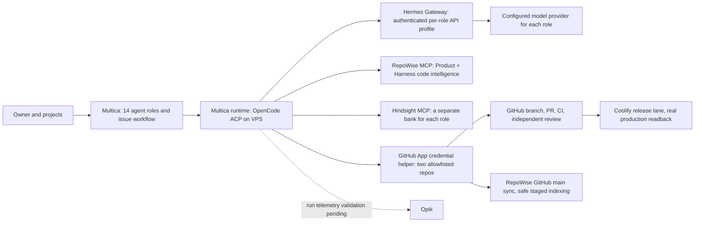

# Żar i Szlif — Execution, Model Routing and Knowledge Architecture

> Canonical source: harness Git repository; indexed by RepoWise. Updated: 2026-11-10.
> Evidence label: **configured / observed / tested**, not a completed production cutover.

## 1. Authority and separation of responsibilities

| System | Authoritative for | Not authoritative for |
|---|---|---|
| GitHub (Product and Harness) | Source code, immutable commits, PR reviews, CI status, release source SHA | Agent memory or currently running image without readback |
| RepoWise | Indexed code graph, cross-repo dependencies, system documentation, architectural decisions, change impact | Task status, runtime deployment state, private episodic memories |
| Multica | Workspaces, agent roles, assignments, issues, runtime orchestration, specialist skills and per-agent MCP bindings | Code facts better read from RepoWise, production release confirmation |
| Hermes Gateway | Role-specific model API, auth boundary and model routing | Source of truth for Git changes or task completion |
| Hindsight | Role-isolated episodic lessons and recalls | Duplicated codebase docs, Git history, architecture decisions |
| GitHub App | Short-lived, repo-scoped Git credentials for authorized changes | Persistent model secrets or unrestricted repository access |
| Coolify | Deployment orchestration and actual container/service state | Approved source identity without SHA/digest checks |
| Opik | Run/model telemetry (planned for Multica full E2E) | Canonical code docs, completion evidence on its own |
| Paperclip | Historical read-only migration source until independently confirmed cutover | Any writes or resumed production agent execution |

This separation prevents the same code facts being stored in Hindsight and RepoWise, and prevents Multica issues such as ZARI-2 from becoming a replacement architecture wiki.

## 2. Logical flow

Observed implementation uses **OpenCode as Multica execution provider** and OpenCode-compatible models `hermes-<role>/<role>`. This is NOT proof that the native Hermes ACP runtime is active; the current daemon reports `Agents: opencode`. Do not describe it as a native Hermes daemon.

## 3. Exact role mapping

All entries below are migrated from historical Paperclip role metadata and created in Multica. An agent definition is not evidence of a successful execution.

| Agent | Supervising role | Multica model (routes to Hermes Gateway) | Hindsight MCP bank |
|---|---|---|---|
| CEO | — | `hermes-ceo/ceo` | `hindsight-ceo` |
| CHO | CEO | `hermes-cho/cho` | `hindsight-cho` |
| CMO | CEO | `hermes-cmo/cmo` | `hindsight-cmo` |
| COO | CEO | `hermes-coo/coo` | `hindsight-coo` |
| CPO | CEO | `hermes-cpo/cpo` | `hindsight-cpo` |
| CTO | CEO | `hermes-cto/cto` | `hindsight-cto` |
| Designer | CTO | `hermes-designer/designer` | `hindsight-designer` |
| Email Creative | CMO | `hermes-email-creative/email-creative` | `hindsight-email-creative` |
| Engineer | CTO | `hermes-engineer/engineer` | `hindsight-engineer` |
| Harness Engineer | CHO | `hermes-harness-engineer/harness-engineer` | `hindsight-harness-engineer` |
| Lifecycle Ops | CMO | `hermes-lifecycle-ops/lifecycle-ops` | `hindsight-lifecycle-ops` |
| Mascot Designer | CPO | `hermes-mascot-designer/mascot-designer` | `hindsight-mascot-designer` |
| MCP Engineer | CTO | `hermes-mcp-engineer/mcp-engineer` | `hindsight-mcp-engineer` |
| UI QA | CTO | `hermes-ui-qa/ui-qa` | `hindsight-ui-qa` |

Routing rule: an agent may only reach the matching Gateway model/profile and the matching Hindsight bank. Cross-role memory access must be tested for denial, not inferred from a `200 /health` response. Sharing one root Hindsight memory across all agents is prohibited.

## 4. Current deployment wiring (VPS)

- Multica self-hosted backend and frontend in Coolify; production workspace slug `zar-i-szlif`, UUID `28378cc8-2c3a-4f8e-af1c-63e308407b17`.
- Separate systemd unit `multica-zar-daemon.service`, profile `zar-prod`, service account `multica-zar`, working directory `/srv/multica-zar`. The separate `brutal-e2e-opencode` process belongs to the test workspace and is not a substitute.
- OpenCode runtime ID `2a9b818b-ebb3-4ab1-b2d1-3dd4501f3272`; the OpenCode config `/srv/multica-zar/.config/opencode/opencode.json` has 14 `hermes-<role>` provider entries. Per-role Gateway API bases and API keys are projected to private `/srv/multica-zar/.config/hermes/<role>/` files.
- The systemd timer `multica-zar-hermes-keys-refresh.timer` refreshes role-scoped Gateway/Hindsight credentials from existing infrastructure. The mapping of hyphenated roles to underscore-separated Hindsight environment names is required.
- Workspace MCP library holds `repowise` plus 14 `hindsight-<role>` entries. MCP entries should bind per agent; only the matched role bank may be assigned, never an all-banks server.
- RepoWise runs as a separate Coolify MCP service and indexes `harness` and `product` aliases; its HTTP MCP requires authentication. The host-side credential is read from a private file, not committed or placed in agent prompts.
- GitHub App installation token is refreshed by `multica-zar-github-app-refresh.timer`; `git` credential helper is `/usr/local/libexec/multica-zar-git-credential`, allowlisting `zar-i-szlif` and `harness-zar-i-szlif` only.
- Model or MCP provider success must not silently fall back. A fallback without positive identification of provider, model, tools and scope is a failed gate.

## 5. Canonical documentation and RepoWise ingestion

**GitHub harness `main` is the durable source of this file; RepoWise is the searchable, versioned architectural index.** RepoWise also indexes Product but Product code should not be rewritten merely to add a systems-level document.

Existing safe updater `/opt/repowise-knowledge/sync-from-github.sh` stages GitHub `main`, checks revisions, rebuilds the index, verifies and promotes with rollback logic. Do not edit the live volume or the temporary copy under `/opt/repowise-knowledge/staging-*` as a documentation source: the next sync can overwrite such changes.

The RepoWise native decision store contains the decision "RepoWise is the canonical architecture knowledge index for Żar i Szlif". It must be aligned with this tracked document; agent-initiated ADRs remain proposed until reviewed. Documentation should cite actual code/commit evidence and report runtime observations separately.

## 6. Data ownership — avoid RepoWise / Hindsight duplication

RepoWise stores durable code structure, APIs, dependency graph, decisions, accepted source history, tests and architecture. Hindsight stores bounded learning such as an error fingerprint, verified failed approach, successful fix and relevant issue/run link, within the originating agent bank. Multica stores execution issue metadata and pointers to commits, PRs and deployment evidence.

Never paste entire RepoWise page bodies, source files, Git diffs, architecture manuals or API credentials into Hindsight. Instead retain short references to canonical RepoWise paths/symbols, commit SHAs and outcome summaries. This is a *storage policy*, not proof that automated de-duplication is already enforced.

## 7. E2E gates and observed evidence (10 Nov 2026)

| Gate | Evidence at this snapshot | Result |
|---|---|---|
| Multica authentication and runtime | `zar-prod` authenticated, systemd daemon running, OpenCode online | PASS for runtime availability |
| Role definitions | 14 agents created with role-specific model IDs and imported prompts | PASS for definitions only |
| Gateway route catalog | OpenCode lists all 14 `hermes-<role>/<role>` models | PASS for discovery; inference E2E not confirmed |
| Gateway API | Three roles returned `200` from `/v1/models` and `/health`; extension to 14 roles staged | PARTIAL |
| Hindsight | Engineer Hindsight MCP handshake succeeded and server connected via OpenCode; per-role private keys staged for all 14 | PARTIAL |
| RepoWise MCP | Authenticated HTTP MCP connected from OpenCode; both Git repos indexed | PASS for connection, not end-to-end agent tool execution |
| GitHub App read | `git ls-remote` returned Product and Harness `main` SHAs using repo-scoped helper | PASS for read only; branch/PR agent flow unproven |
| Multica native MCP assignments | Engineer has RepoWise + Hindsight Engineer. Other roles require explicit binding readback | PARTIAL |
| End-to-end agent canary | Multica issue `ZARI-2` failed at `opencode session/prompt` on a RepoWise tool call: expected OpenAI-compatible `choices` or `error`, received tool-running metadata | FAIL — investigate provider/ACP protocol adapter; never call this DONE |
| Review, CI, promotion and production readback | No full independently verified agent implementation-to-Coolify trace in this migration | NOT PROVEN |

The `ZARI-2` issue is a one-time, isolated diagnostic execution, **not** an architecture registry, durable decision or source of truth. Retain the failure fingerprint here and in an E2E test report, not as duplicated architecture inside the task.

## 8. Planned production delivery contract

1. Multica receives an issue that refers to a canonical RepoWise path/decision and assigns the correct role. Owner/CHO delegates; implementation actor and reviewer must be distinct.
2. Runtime identifies exact role model and Gateway profile, obtains current RepoWise code context and the role-scoped Hindsight recall. All tool calls and denials are observable.
3. GitHub App supplies short-lived credentials for the two allowlisted repositories. Agent works in an isolated branch/worktree, never directly on protected release branches.
4. Independent reviewer validates changed paths, threat model, tests and CI against exact candidate SHA. Required changes return to the implementer.
5. Approved SHA is merged; existing CI/Coolify release lane deploys an immutable artifact. Compare merged commit SHA with deployed digest/revision, HTTP endpoints, logs and functional readback.
6. Multica records acceptance evidence and completes the issue only after real production readback. Opik/Hindsight traces are corroborating evidence, not replacements for that readback.
7. RepoWise GitHub sync indexes approved architecture and code changes; Hindsight retains short role-scoped lessons without copying code facts.

## 9. Failure containment and recovery

- A `401` from RepoWise/Hindsight must be diagnosed at its own auth boundary. Do not disable auth or copy one role token to another.
- A missing/invalid Gateway route or malformed tool response is a hard failure. Test provider compatibility, tool-call schema and error translation in isolation before dispatching production-capable tasks.
- No API key in Git, Multica prompts, server-rendered documents, shell arguments or logs. Keep token refresh scoped to server service accounts, mode 0600 and explicit repository/role allowlists.
- On failed checks or readback, stop promotion and revert only the affected reversible component. Preserve the original Paperclip state in read-only mode.
- Collect immutable run ID, MCP tool name, role, model ID, commit SHA, CI evidence, deployment ID/digest and observed outcome without collecting secret values.

## 10. Follow-up verification checklist

- [x] Verify 14/14 agent MCP bindings: exactly RepoWise plus the matching Hindsight bank; verified by live Multica CLI readback.
- [x] Identify the `ZARI-2` OpenCode SSE tool-event schema failure; disable the native Hermes `tool_progress_events` option (strict OpenAI-compatible SSE) and verify `ZARI-3` completes with model output. This is **not** MCP execution E2E: `ZARI-3` reported tools=0.
- [ ] Demonstrate one complete authorized call to RepoWise and one to Hindsight under the same role through Multica, with cross-bank denial.
- [ ] Demonstrate GitHub branch/PR/CI from the same run, with an independent reviewer and safe dry-run deployment/readback.
- [ ] Verify Opik receives linked per-run telemetry without storing secrets.
- [ ] Verify RepoWise sync from the reviewed harness commit and query this architecture back through RepoWise MCP.

## 11. Native Hermes ACP migration checkpoint — 10 Nov 2026

The following is **live configuration/readback evidence**, not proof of production cutover:

| Item | Observed state | Evidence class |
|---|---|---|
| Multica production workspace | `zar-i-szlif` (`28378cc8-2c3a-4f8e-af1c-63e308407b17`) | configured |
| Daemon | `multica-zar-daemon.service` active; service user `multica-zar` | observed |
| Runtime: OpenCode | ID `2a9b818b-ebb3-4ab1-b2d1-3dd4501f3272`, online | observed |
| Runtime: native Hermes ACP | ID `2c84d3ef-7bf7-4e1c-b81a-3078d9e5512c`, online; Hermes 0.22.5 and `hermes acp --check` PASS | observed |
| Model/profile identities | Fourteen role-specific Hermes homes under `/srv/multica-zar/.hermes/profiles/<role>` are staged; 14 corresponding Multica agents exist | configured, not inferred |
| MCP bindings | Exactly `repowise` and `hindsight-<matching-role>` enabled for each of 14 agents | readback PASS, tool calls unproven |
| Multica platform skill | Official bundled `multica-platform` skill imported with nine native references; assigned to 14/14 agents | readback PASS |
| Legacy skills | Thirty Paperclip-derived skills staged in Multica library; none attached. Paperclip read-only source currently lists 34 company skills / 58 total; 29 attached-company skill names needed by roles are staged | migration incomplete |
| Project repository resources | Harness and Product projects both have native `github_repo` resources pointing at the respective canonical GitHub repositories | observed |
| GitHub App | Timed installation-token refresh active; read-only `git ls-remote` of both `main` branches succeeded | readback PASS; agent PR flow unproven |
| Gateway SSE compatibility | Native `platforms.api_server.tool_progress_events: false` configured; Gateway returned healthy; strict-client tool-progress validation error no longer reproduced in model-only `ZARI-3` | PARTIAL |
| Native Hermes inference | `opencode-go/deepseek-v4.1-flash` in isolated Engineer profile could not authenticate: `No usable credentials found for provider 'opencode-go'`. Credential projection was not completed | **FAIL** |
| Multica run → MCP → GitHub → review → CI → Coolify → readback | No full successful trace; `ZARI-2` failed before SSE fix; `ZARI-3` completed model text but performed zero tool calls | **NO-GO** |

**Boundary:** Multica injects a task-scoped `MULTICA_TOKEN` to a *native* Hermes ACP worker. This avoids the previous nested OpenCode → Hermes Gateway model route, where MCP tools were owned by OpenCode but the inner Hermes agent could not invoke them. Presence of the native runtime alone does not prove it uses the correct credential or actually executes tools. Keep the current OpenCode agent assignments unchanged until at least one native Hermes role completes authenticated inference and real RepoWise+Hindsight calls under its task token.

**Credential handling:** Do not copy an owner's full Multica PAT into agents, embed model or MCP keys in prompts, or remove auth checks to make a test pass. Per-task or role-scoped credentials only. Paperclip is migration evidence read-only. An unavailable provider key is a real deployment blocker; no silent alternative model.

**Exit criteria:** Successful native Hermes `session/new` and `session/prompt`; model identity readback; a RepoWise tool call and a role-scoped Hindsight recall under the *same* Multica task; negative cross-bank access test; native GitHub branch/PR/CI plus independent review; approved merged SHA deployed by Coolify, checked against container image, HTTP and functional readback; linked Opik trace. Only then change migration status to DONE.

## 12. Verified live role and MCP runtime checks — 10 Nov 2026

**Production cutover verdict: NO-GO.** These are direct CLI/Multica MCP and Coolify readbacks, not aspirational statuses. Paperclip was accessed READ ONLY. All issues listed below belong to the existing Multica workspace (not a new test workspace).

### Basic role/skill execution evidence

The following eight existing non-production issues ran to `completed` and produced an in-issue agent comment beginning `MIGRATION_E2E=PASS`:

| Agent | Test issue | Observed outcome |
|---|---|---|
| Engineer | `ZARI-17` | PASS: read task, load native and role skills, write comment |
| Designer | `ZARI-10` | PASS: role/skill response and issue comment |
| Lifecycle Ops | `ZARI-11` | PASS: role/skill response and issue comment |
| Harness Engineer | `ZARI-13` | PASS: role/skill response and issue comment |
| Email Creative | `ZARI-14` | PASS: role/skill response and issue comment |
| MCP Engineer | `ZARI-15` | PASS: role/skill response and issue comment |
| UI QA | `ZARI-16` | PASS: role/skill response and issue comment |
| Mascot Designer | `ZARI-18` | PASS: role/skill response and issue comment |

The six C-level roles are **not validated**: `ZARI-5` CTO, `ZARI-6` CMO, `ZARI-7` COO, `ZARI-9` CPO and `ZARI-12` CHO had failed runs with `opencode model selection failed` for source model `openai/gpt-6-luna`. `ZARI-8` CEO initially failed for the same reason, then had a later technically completed run, but its reported comment was `MIGRATION_E2E=FAIL`. **Never count a completed run with a FAIL acceptance comment as successful.** The eight PASS tests executed on OpenCode; **none proves native Hermes routing**. Do not silently replace a source model or claim equivalence after a model substitution.

The official bundled `multica-platform` skill is attached to 14/14 roles. Source-derived role skills are also now attached in the active workspace. Selected skill bodies include a `Multica migration note` that marks Paperclip-specific instructions reference-only. Name parity is not function parity and requires separate behavioural regression tests.

### Tool execution and confinement failure

`ZARI-20` was a bounded read-only actual MCP acceptance test in the **existing Harness project**, run by Engineer. It did load `multica-platform` and read its issue. It did **not** demonstrate an actual RepoWise MCP call or Hindsight recall, despite `agent mcp list` showing `repowise` plus `hindsight-engineer` enabled. The runtime tool list exposed some Hindsight tools but not RepoWise tools. Agent expanded to shell-based runtime configuration inspection, violating the narrow read-only-tool restriction. Operator cancelled run `01a1c5f0-7170-7846-bcc7-d77e7ef40132`, cancelled and unassigned `ZARI-20`, and recorded the failure. **Connected/assigned MCP != callable MCP.** The acceptance gate requires actual `tool_use` and successful `tool_result` for each named service, with a separate cross-bank negative test.

### Coolify RepoWise MCP storage diagnosis

At diagnosis, `repowise-mcp` application `fciqzgceop7mqtqickkfomd7` was `exited:unhealthy` with no container, while primary `repowise` app `oea9obpkhzbgkmipxwqmz2hj` was healthy. Existing main RepoWise indexes both Harness and Product; Harness index confirmed exact commit `5ee1dbbfb040397dc14207ba40fef58b60adb10d`.

The native MCP application was started via Coolify for diagnosis. Container returned healthy but logged `No .repowise directory found at /repo`; crucially its persistent storage list was **empty**. Main RepoWise has two named volumes, mounted at `/workspace` and `/data`. Attempting to attach those by name through standalone application storage created **new UUID-prefixed volumes** rather than reusing originals. Both new entries were deleted **before redeployment**. The empty MCP instance was stopped and its final readback was `exited:unhealthy` / `container_present=false`. The primary RepoWise instance and the separately connected RepoWise plugin were not stopped, and the indexed Harness SHA remained unchanged.

Native Coolify 4.4.6 storage mounts prefix names by app UUID and do not allow arbitrary `--mount` or `-v` in Custom Docker Options. Docker Compose `volumes: ... external: true` is the documented native cross-resource reuse mechanism; converting the present Dockerfile application to Compose requires an explicit controlled deployment plan, backup/snapshot and post-deploy source index readback before activation. Do not deploy an MCP process with an empty `/repo` and call it ready. If using the existing separately connected RepoWise MCP instead, confirm its exact stable endpoint and task-level authorization before changing the workspace library.

Docs: https://coolify.io/docs/core/persistent-storage/storage-mounts/volume-mounts and https://coolify.io/docs/applications/builds/custom-docker-options .

### Additional real blockers / production release readback

- Native Hermes runtime ID `2c84d3ef-7bf7-4e1c-b81a-3078d9e5512c` and OpenCode runtime ID `2a9b818b-ebb3-4ab1-b2d1-3dd4501f3272` both report online. Production role agents remain on OpenCode, because native Hermes inference with `opencode-go/deepseek-v4.1-flash` failed authentication (`No usable credentials found for provider 'opencode-go'`). Native Hermes ACP installation/probe is not a substitute for authenticated inference plus MCP operations.
- Ubuntu SSH MCP returned `UNAUTHORIZED` during the latest host checks. Do not bypass by another tool or force credentials into CLI arguments; reconnect authorized access before touching host profile files, model credentials, or runtime transport. The Hermes Gateway container was reported healthy in Coolify at last check.
- Paperclip read-only inventory reported 14 agents, 58 total skill entries (34 company), 15 projects, and 1260 issues: 808 done, 437 cancelled, 15 open. These 15 open issues have first-class parent/blocker/review/document relationships. Do not mass-dispatch them or flatten their dependency graph into plain descriptions. No full lossless issue migration has been proven.
- Product Coolify `zar-i-szlif-web` follows `ci-approved` with **automatic deployment disabled**. Last confirmed successful release SHA `98cd058155dbf4c268777246fc510324f98f7dc5` matched `ci-approved`; `main` was one commit ahead at check. This verifies one exact-SHA alignment, not agent-driven PR/CI/promotion/rollback E2E.
- Opik connector did not return reliable recent trace list during this validation; cross-system trace lineage remains unproven.

**Next controlled gate:** Re-authorize host access; configure task-scoped provider auth for native Hermes (not a workspace-owner PAT); repair/replace RepoWise task-level MCP endpoint using the indexed workspace; prove RepoWise + Hindsight `tool_use/tool_result` in ONE native Hermes run with negative cross-bank denial; reconcile the six C-level source models; perform an authorized PR/CI/merge/Coolify release/readback/rollback canary with independent review; migrate open Paperclip tasks only when required first-class dependencies can be represented. Keep NO-GO until all gates have immutable evidence.

### Verified role-test reruns and RepoWise HTTP deploy state — 2026-11-10 15:17 UTC

**Latest run-state (append-only evidence):** Multica issues `ZARI-5` through `ZARI-18` all have a newest `completed` role-profile test run and a corresponding `MIGRATION_E2E=PASS` comment from their assigned agent. Earlier `opencode model selection failed` attempts on C-level roles (and the CEO's earlier `MIGRATION_E2E=FAIL`) remain retained in run history. **This is 14/14 PASS for role/profile/skill/issue-comment tests only.** The cross-functional fictional hierarchy `ZARI-21` to `ZARI-24` has CTO, CMO, nested UI QA, and CEO `completed` runs with `MIGRATION_FLOW=PASS` comments. These tests do not claim actual external tools, model parity, production releases, or independent review acceptance; current issue status `in_review` is distinct from `done`.

**Real MCP gate remains FAIL:** `ZARI-20` was cancelled: the assigned Engineer did not successfully invoke RepoWise despite enabled bindings, and performed disallowed shell-based config exploration; Hindsight/RepoWise tool-use evidence in the same task remains absent. The current `repowise-mcp` Dockerfile image is a **stdio** MCP image (`ENTRYPOINT ["repowise", "mcp"]`), whereas a persistent Coolify HTTP endpoint requires `repowise mcp /workspace --transport streamable-http --host 0.0.0.0 --port 7338` with actual indexed workspace data. Coolify app `fciqzgceop7mqtqickkfomd7` was `exited:unhealthy`; the main indexed RepoWise instance `oea9obpkhzbgkmipxwqmz2hj` remained operational. Main app volumes are named `oea9obpkhzbgkmipxwqmz2hj-repowise-workspace` and `oea9obpkhzbgkmipxwqmz2hj-repowise-data`, at `/workspace` and `/data`. Coolify 4.4.6 standalone storage auto-prefixes names. Two accidentally newly prefixed, empty storage bindings were deleted before any redeploy.

A **replacement HTTP MCP Docker Compose service** in existing Coolify project `repowise-knowledge` was attempted with native streamable-http transport and *read-only* `external: true` volumes, with the existing old-MCP API key configured (without publishing its value). Its application/container did **not** start or pass health. Resource `crtr3dmwpvleo4ez14q5rd3i` is explicitly renamed `repowise-mcp-http-NOT-DEPLOYED`, status `exited`, and **must not be used as an endpoint**. Its deletion request was denied because the Coolify connector requires interactive human confirmation for destructive actions; nothing was deleted. Existing RepoWise indexes are unchanged. Reconcile this staged resource with authorized server diagnostics before a deployment or removal. Do not mistake a queued Coolify start for a running container.

**Remaining strict NO-GO requirements:** authorized Ubuntu host access (currently `UNAUTHORIZED` even for server listing), authenticated native Hermes `session/prompt` with scoped credentials, actual RepoWise+role-isolated Hindsight `tool_use/tool_result` from the *same* Multica task plus cross-bank denial, 14-role source-model compatibility evidence, first-class Paperclip DAG and review semantics, a reviewed PR and CI, exact-SHA Coolify deployment/readback and rollback, and linked Opik trace. Preserve read-only Paperclip and current production configuration until those gates pass.
