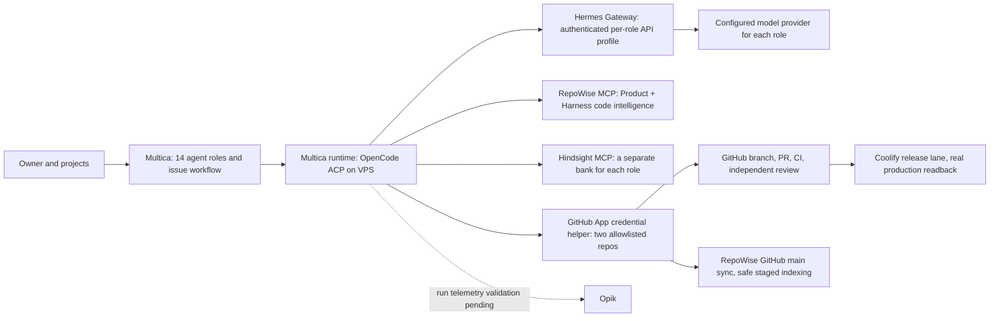

# Żar i Szlif — Execution, Model Routing and Knowledge Architecture

> Canonical source: harness Git repository; indexed by RepoWise. Updated: 2026-11-10.
> Evidence label: **configured / observed / tested**, not a completed production cutover.

## 1. Authority and separation of responsibilities

| System | Authoritative for | Not authoritative for |
|---|---|---|
| GitHub (Product and Harness) | Source code, immutable commits, PR reviews, CI status, release source SHA | Agent memory or currently running image without readback |
| RepoWise | Indexed code graph, cross-repo dependencies, system documentation, architectural decisions, change impact | Task status, runtime deployment state, private episodic memories |
| Multica | Workspaces, agent roles, assignments, issues, runtime orchestration, specialist skills and per-agent MCP bindings | Code facts better read from RepoWise, production release confirmation |
| Hermes Gateway | Role-specific model API, auth boundary and model routing | Source of truth for Git changes or task completion |
| Hindsight | Role-isolated episodic lessons and recalls | Duplicated codebase docs, Git history, architecture decisions |
| GitHub App | Short-lived, repo-scoped Git credentials for authorized changes | Persistent model secrets or unrestricted repository access |
| Coolify | Deployment orchestration and actual container/service state | Approved source identity without SHA/digest checks |
| Opik | Run/model telemetry (planned for Multica full E2E) | Canonical code docs, completion evidence on its own |
| Paperclip | Historical read-only migration source until independently confirmed cutover | Any writes or resumed production agent execution |

This separation prevents the same code facts being stored in Hindsight and RepoWise, and prevents Multica issues such as ZARI-2 from becoming a replacement architecture wiki.

## 2. Logical flow

Observed implementation uses **OpenCode as Multica execution provider** and OpenCode-compatible models `hermes-<role>/<role>`. This is NOT proof that the native Hermes ACP runtime is active; the current daemon reports `Agents: opencode`. Do not describe it as a native Hermes daemon.

## 3. Exact role mapping

All entries below are migrated from historical Paperclip role metadata and created in Multica. An agent definition is not evidence of a successful execution.

| Agent | Supervising role | Multica model (routes to Hermes Gateway) | Hindsight MCP bank |
|---|---|---|---|
| CEO | — | `hermes-ceo/ceo` | `hindsight-ceo` |
| CHO | CEO | `hermes-cho/cho` | `hindsight-cho` |
| CMO | CEO | `hermes-cmo/cmo` | `hindsight-cmo` |
| COO | CEO | `hermes-coo/coo` | `hindsight-coo` |
| CPO | CEO | `hermes-cpo/cpo` | `hindsight-cpo` |
| CTO | CEO | `hermes-cto/cto` | `hindsight-cto` |
| Designer | CTO | `hermes-designer/designer` | `hindsight-designer` |
| Email Creative | CMO | `hermes-email-creative/email-creative` | `hindsight-email-creative` |
| Engineer | CTO | `hermes-engineer/engineer` | `hindsight-engineer` |
| Harness Engineer | CHO | `hermes-harness-engineer/harness-engineer` | `hindsight-harness-engineer` |
| Lifecycle Ops | CMO | `hermes-lifecycle-ops/lifecycle-ops` | `hindsight-lifecycle-ops` |
| Mascot Designer | CPO | `hermes-mascot-designer/mascot-designer` | `hindsight-mascot-designer` |
| MCP Engineer | CTO | `hermes-mcp-engineer/mcp-engineer` | `hindsight-mcp-engineer` |
| UI QA | CTO | `hermes-ui-qa/ui-qa` | `hindsight-ui-qa` |

Routing rule: an agent may only reach the matching Gateway model/profile and the matching Hindsight bank. Cross-role memory access must be tested for denial, not inferred from a `200 /health` response. Sharing one root Hindsight memory across all agents is prohibited.

## 4. Current deployment wiring (VPS)

- Multica self-hosted backend and frontend in Coolify; production workspace slug `zar-i-szlif`, UUID `28378cc8-2c3a-4f8e-af1c-63e308407b17`.
- Separate systemd unit `multica-zar-daemon.service`, profile `zar-prod`, service account `multica-zar`, working directory `/srv/multica-zar`. The separate `brutal-e2e-opencode` process belongs to the test workspace and is not a substitute.
- OpenCode runtime ID `2a9b818b-ebb3-4ab1-b2d1-3dd4501f3272`; the OpenCode config `/srv/multica-zar/.config/opencode/opencode.json` has 14 `hermes-<role>` provider entries. Per-role Gateway API bases and API keys are projected to private `/srv/multica-zar/.config/hermes/<role>/` files.
- The systemd timer `multica-zar-hermes-keys-refresh.timer` refreshes role-scoped Gateway/Hindsight credentials from existing infrastructure. The mapping of hyphenated roles to underscore-separated Hindsight environment names is required.
- Workspace MCP library holds `repowise` plus 14 `hindsight-<role>` entries. MCP entries should bind per agent; only the matched role bank may be assigned, never an all-banks server.
- RepoWise runs as a separate Coolify MCP service and indexes `harness` and `product` aliases; its HTTP MCP requires authentication. The host-side credential is read from a private file, not committed or placed in agent prompts.
- GitHub App installation token is refreshed by `multica-zar-github-app-refresh.timer`; `git` credential helper is `/usr/local/libexec/multica-zar-git-credential`, allowlisting `zar-i-szlif` and `harness-zar-i-szlif` only.
- Model or MCP provider success must not silently fall back. A fallback without positive identification of provider, model, tools and scope is a failed gate.

## 5. Canonical documentation and RepoWise ingestion

**GitHub harness `main` is the durable source of this file; RepoWise is the searchable, versioned architectural index.** RepoWise also indexes Product but Product code should not be rewritten merely to add a systems-level document.

Existing safe updater `/opt/repowise-knowledge/sync-from-github.sh` stages GitHub `main`, checks revisions, rebuilds the index, verifies and promotes with rollback logic. Do not edit the live volume or the temporary copy under `/opt/repowise-knowledge/staging-*` as a documentation source: the next sync can overwrite such changes.

The RepoWise native decision store contains the decision "RepoWise is the canonical architecture knowledge index for Żar i Szlif". It must be aligned with this tracked document; agent-initiated ADRs remain proposed until reviewed. Documentation should cite actual code/commit evidence and report runtime observations separately.

## 6. Data ownership — avoid RepoWise / Hindsight duplication

RepoWise stores durable code structure, APIs, dependency graph, decisions, accepted source history, tests and architecture. Hindsight stores bounded learning such as an error fingerprint, verified failed approach, successful fix and relevant issue/run link, within the originating agent bank. Multica stores execution issue metadata and pointers to commits, PRs and deployment evidence.

Never paste entire RepoWise page bodies, source files, Git diffs, architecture manuals or API credentials into Hindsight. Instead retain short references to canonical RepoWise paths/symbols, commit SHAs and outcome summaries. This is a *storage policy*, not proof that automated de-duplication is already enforced.

## 7. E2E gates and observed evidence (10 Nov 2026)

| Gate | Evidence at this snapshot | Result |
|---|---|---|
| Multica authentication and runtime | `zar-prod` authenticated, systemd daemon running, OpenCode online | PASS for runtime availability |
| Role definitions | 14 agents created with role-specific model IDs and imported prompts | PASS for definitions only |
| Gateway route catalog | OpenCode lists all 14 `hermes-<role>/<role>` models | PASS for discovery; inference E2E not confirmed |
| Gateway API | Three roles returned `200` from `/v1/models` and `/health`; extension to 14 roles staged | PARTIAL |
| Hindsight | Engineer Hindsight MCP handshake succeeded and server connected via OpenCode; per-role private keys staged for all 14 | PARTIAL |
| RepoWise MCP | Authenticated HTTP MCP connected from OpenCode; both Git repos indexed | PASS for connection, not end-to-end agent tool execution |
| GitHub App read | `git ls-remote` returned Product and Harness `main` SHAs using repo-scoped helper | PASS for read only; branch/PR agent flow unproven |
| Multica native MCP assignments | Engineer has RepoWise + Hindsight Engineer. Other roles require explicit binding readback | PARTIAL |
| End-to-end agent canary | Multica issue `ZARI-2` failed at `opencode session/prompt` on a RepoWise tool call: expected OpenAI-compatible `choices` or `error`, received tool-running metadata | FAIL — investigate provider/ACP protocol adapter; never call this DONE |
| Review, CI, promotion and production readback | No full independently verified agent implementation-to-Coolify trace in this migration | NOT PROVEN |

The `ZARI-2` issue is a one-time, isolated diagnostic execution, **not** an architecture registry, durable decision or source of truth. Retain the failure fingerprint here and in an E2E test report, not as duplicated architecture inside the task.

## 8. Planned production delivery contract

1. Multica receives an issue that refers to a canonical RepoWise path/decision and assigns the correct role. Owner/CHO delegates; implementation actor and reviewer must be distinct.
2. Runtime identifies exact role model and Gateway profile, obtains current RepoWise code context and the role-scoped Hindsight recall. All tool calls and denials are observable.
3. GitHub App supplies short-lived credentials for the two allowlisted repositories. Agent works in an isolated branch/worktree, never directly on protected release branches.
4. Independent reviewer validates changed paths, threat model, tests and CI against exact candidate SHA. Required changes return to the implementer.
5. Approved SHA is merged; existing CI/Coolify release lane deploys an immutable artifact. Compare merged commit SHA with deployed digest/revision, HTTP endpoints, logs and functional readback.
6. Multica records acceptance evidence and completes the issue only after real production readback. Opik/Hindsight traces are corroborating evidence, not replacements for that readback.
7. RepoWise GitHub sync indexes approved architecture and code changes; Hindsight retains short role-scoped lessons without copying code facts.

## 9. Failure containment and recovery

- A `401` from RepoWise/Hindsight must be diagnosed at its own auth boundary. Do not disable auth or copy one role token to another.
- A missing/invalid Gateway route or malformed tool response is a hard failure. Test provider compatibility, tool-call schema and error translation in isolation before dispatching production-capable tasks.
- No API key in Git, Multica prompts, server-rendered documents, shell arguments or logs. Keep token refresh scoped to server service accounts, mode 0600 and explicit repository/role allowlists.
- On failed checks or readback, stop promotion and revert only the affected reversible component. Preserve the original Paperclip state in read-only mode.
- Collect immutable run ID, MCP tool name, role, model ID, commit SHA, CI evidence, deployment ID/digest and observed outcome without collecting secret values.

## 10. Follow-up verification checklist

- [ ] Verify all 14 agent MCP bindings: exactly RepoWise plus the matching Hindsight bank.
- [ ] Reproduce and fix the `ZARI-2` OpenCode ACP/provider tool-event schema failure, with a regression test.
- [ ] Demonstrate one complete authorized call to RepoWise and one to Hindsight under the same role through Multica, with cross-bank denial.
- [ ] Demonstrate GitHub branch/PR/CI from the same run, with an independent reviewer and safe dry-run deployment/readback.
- [ ] Verify Opik receives linked per-run telemetry without storing secrets.
- [ ] Verify RepoWise sync from the reviewed harness commit and query this architecture back through RepoWise MCP.
